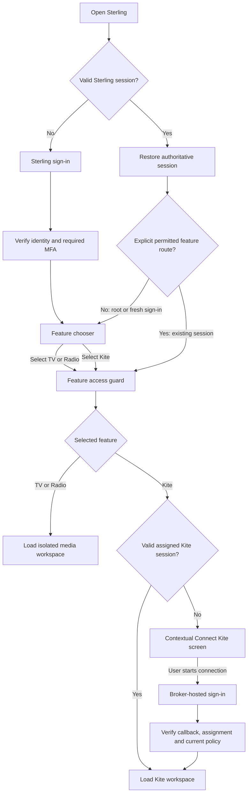

# Sterling account management and experience overhaul

**Implementation specification · version 1.1 · 27 October 2026 (IST)**

**Status:** Proposal for review. No application implementation or deployment is included in this document.

**Purpose:** Rebuild Sterling around one administrator, independently controlled Kite/TV/Radio access, centralized broker assignment and integration-secret management, an intentional feature launcher, and a consistent premium experience. Extend the work into performance, reliability, internal engines, accessibility, testing, and operations through explicit delivery stages.

**Version 1.1 scope update:** The admin centrally creates/manages broker connections and integration credentials, assigns broker accounts to Sterling users, and explicitly selects which users can see and use credential-management controls. This replaces version 1.0's proposal to retain user-owned broker setup as the default. Application implementation remains out of scope for this document-only phase.

**Inspected checkout:** `/home/nageshmadaram/Sterling`, branch `codex/implementation-spec-20261026`, HEAD `c83f44b0115e0f92ab678fd74435e3f7599eab72`. Existing modified/untracked operational evidence was present and was left untouched. The running frontend may represent a different committed release; checkout findings are not certification of the deployed backend.

**Reading guide:** [Product and findings](#1-the-proposed-product) → [account rules](#3-account-and-permission-rules) → [delegated settings](#34-delegated-configuration-capabilities) → [user journeys](#4-user-journeys-and-state-machines) → [administration](#5-administration-experience) → [central broker registry](#54-central-broker-registry-and-assignment) → [keys and integrations](#56-central-keys-secrets-and-integration-management) → [authentication](#6-authentication-device-sessions-and-recovery) → [data and APIs](#7-persistence-and-consistency-design) → [authorization](#9-authorization-coverage-and-protected-media) → [code architecture](#10-frontend-architecture-and-code-design) → [design](#11-visual-design-specification) → [motion](#12-motion-and-transitions) → [engines](#14-internal-engine-upgrade-program) → [quality targets](#15-performance-and-reliability-targets) → [migration](#17-migration-and-rollout) → [verification](#18-verification-and-acceptance-plan) → [delivery order](#19-implementation-work-packages-and-order).

## 1. The proposed product

Sterling becomes a personal workspace with three destinations: **Kite**, **TV**, and **Radio**. Users sign in to Sterling once, see the destinations enabled for their account, and choose what to open. The administrator manages users, feature access, broker assignments, API credentials, Telegram integrations, and delegated configuration permissions from a dedicated **Administration** workspace that never requires a Kite connection.

Ordinary users see their assigned connections and useful connection/alert status, without broker API-key forms, bot-token fields, or technical configuration clutter. Only users selected by the admin receive the relevant configuration sections and server-enforced editing permissions. A user may connect an assigned broker without being allowed to inspect or change its API secrets.

Kite authentication becomes a second, contextual step. It appears only after a user with Kite permission chooses Kite and Sterling confirms that a broker connection is needed. Choosing TV or Radio does not mount the trading workspace, request broker credentials, or start broker login.

The visual direction is **Sterling Studio**: restrained dark and light surfaces, clear typography, precise spacing, a recognizable warm Sterling accent, and focused motion. Richness comes from coherent interactions, responsive layouts, and useful feedback. Trading controls prioritize legibility and operational clarity.

The user's current **3/10** assessment is the starting product feedback. “10/10” is an ambition; this specification translates it into observable acceptance gates. It does not claim that all existing engines have been audited or that redesign can establish strategy profitability.

### 1.1 Required outcomes

| ID | Outcome | Acceptance condition |
|---|---|---|
| R01 | Exactly one administrator | Storage and services reject a second admin and reject deletion, suspension, or demotion of the designated admin. Recovery restores that identity. |
| R02 | Complete account management | Admin can create, inspect, update, suspend, restore, reset access, and delete ordinary Sterling logins. Every committed change is audited. |
| R03 | Independent feature permissions | Each account has explicit Kite, TV, and Radio grants, with all eight grant combinations supported. |
| R04 | Intentional first destination | Fresh Sterling sign-in lands on a chooser, including when only one feature is enabled. |
| R05 | Conditional Kite login | No Kite permission or no Kite selection means no broker login UI and no login attempt. |
| R06 | Access enforced outside the UI | APIs, streams, direct media documents, alternate ingress paths, callbacks, and background entry admission enforce the relevant policy. |
| R07 | Premium login and administration | New layouts, responsive states, keyboard behavior, coherent themes, motion, and useful error recovery pass the design checklist. |
| R08 | Strong session lifecycle | Explicit device remembrance, finite expiry, device revocation, safe refresh, and no persistent browser bearer tokens in the target architecture. |
| R09 | Feature isolation | TV/Radio sessions do not load the Kite runtime; media content retains its opaque-origin sandbox. |
| R10 | Safe trading continuity | Logout, feature switching, or account removal does not accidentally terminate existing position protection or trigger a trade. |
| R11 | Measured improvements | Performance and reliability targets have release-specific evidence, with unknown or failed measures clearly reported. |
| R12 | Whole-app upgrade program | Every engine/workstream has a bounded change plan, tests, an accountable owner, and release gates. |
| R13 | Central broker registry and assignment | Admin can add/manage broker records independently of a user and assign/reassign them to any ordinary or admin Sterling identity through a safe, audited lifecycle. |
| R14 | Central integration and secret management | Broker API credentials, Telegram bot credentials/destinations, and supported provider/integration keys are managed centrally with encrypted storage, masking, versioning, and audit. |
| R15 | Selected-user configuration delegation | Admin can show/hide Broker, Telegram, and eligible Integration settings per user and grant resource-scoped create/update/test/reveal actions separately. Hidden/unauthorized controls cannot be used through old URLs or APIs. |
| R16 | Clean ordinary-user experience | Default users can use entitled features, connect assigned brokers, and view safe status without seeing add/modify/reveal key controls. |

### 1.2 Scope boundaries

This specification covers the three requested feature entitlements, centralized broker/integration administration, and selected-user delegation. A **Sterling user** is a first-party identity; a **broker account** is a centrally registered connection to a verified provider account; an **assignment** authorizes a Sterling user to use that connection. Broker legal ownership, Sterling administration, assignment, feature access, key management, and live execution authorization are separate facts. A feature grant or reassignment does not change exchange entitlements or strategy promotion.

Preserve the existing Live/Simulation separation and owner restrictions. Simulation remains a mode inside the permitted Kite workspace; its current owner-only rule is not widened by this redesign. Keep existing release-scope and risk authorities authoritative. Upgrading an engine does not enable an experimental strategy or alter its entry/exit rules without a separately reviewed change.

## 2. Evidence from the existing application

The repository requests code-review-graph tools before code exploration. Those tools were absent from the available session tools, so focused source reads were used as the fallback. Inspection covered auth, user management, the main shell, media isolation, streaming, configuration manifests, and existing operational contracts. The local published sign-in page was inspected without submitting credentials. No full runtime audit, load test, permission mutation, broker action, or strategy certification was performed.

| Finding | Evidence | Consequence and resolution |
|---|---|---|
| User CRUD already exists | [User endpoints](/home/nageshmadaram/Sterling/backend/app/api/v1/endpoints/sterling_users.py:35), [credential service](/home/nageshmadaram/Sterling/backend/app/services/auth/operator_credentials.py:9) | Reuse its durable transaction, conflict handling, and audit-identity retention; move it into independent administration. |
| User data has role and active flags, without feature grants | [User model and table](/home/nageshmadaram/Sterling/backend/app/services/auth/user_store.py:39) | Introduce first-class entitlements and account lifecycle status; do not derive permission from personal UI settings. |
| Services allow creating/promoting additional admins | [Role validation](/home/nageshmadaram/Sterling/backend/app/services/auth/operator_credentials.py:27) | Add singleton administration invariants at the database and service layers. |
| `/auth/me` returns only identity and role | [Identity response](/home/nageshmadaram/Sterling/backend/app/api/v1/endpoints/auth.py:60) | Add a versioned session bootstrap response with authoritative permissions and safe presentation data. |
| Login mounts the dashboard and broker-link entry after verification | [Login gate](/home/nageshmadaram/Sterling/frontend/src/components/auth/LoginGate.tsx:84), [application shell](/home/nageshmadaram/Sterling/frontend/src/App.tsx:25) | Insert the feature launcher before mounting any feature runtime. Scope broker-link handling to selected Kite. |
| Kite stays mounted while other destinations are selected | [Hidden Kite panel](/home/nageshmadaram/Sterling/frontend/src/pages/SimpleTerminal.tsx:417) | Replace hidden mounting with route-based lazy mounting. This is a verified mounting behavior; its performance cost has not yet been measured. |
| Experience settings control visible destinations | [Workspace selection](/home/nageshmadaram/Sterling/frontend/src/pages/SimpleTerminal.tsx:73) | Compute visible destinations as server grants intersected with presentation preferences. Preferences can never grant access. |
| TV and Radio HTML are served directly | [Node media serving](/home/nageshmadaram/Sterling/scripts/serve_frontend.mjs:120), [Nginx media locations](/home/nageshmadaram/Sterling/frontend/nginx.conf:145) | Guard the actual documents at both gateways. A launcher-only access check leaves a direct URL bypass. |
| Media sandboxing is already deliberate | [TV wrapper](/home/nageshmadaram/Sterling/frontend/src/components/tv/TvWorkspace.tsx:1), [Radio wrapper](/home/nageshmadaram/Sterling/frontend/src/components/radio/RadioWorkspace.tsx:37) | Preserve opaque origins, narrow message schemas, and frame-source validation throughout redesign. |
| Access and refresh tokens are persisted in browser storage | [Token storage](/home/nageshmadaram/Sterling/frontend/src/utils/auth.ts:52) | Migrate to in-memory access tokens and a protected server-backed device session. |
| Remembering is automatic; remembered refresh tokens have no `exp` | [Automatic remembrance](/home/nageshmadaram/Sterling/frontend/src/components/auth/LoginGate.tsx:44), [refresh token minting](/home/nageshmadaram/Sterling/backend/app/core/tokens.py:62) | Add an explicit user choice, finite session lifetimes, refresh rotation, and legacy-token retirement. Existing revocation checks are valuable and should remain. |
| Disabling a login currently requires removing its broker accounts first | [Deletion guard](/home/nageshmadaram/Sterling/backend/app/services/auth/operator_credentials.py:35) | Separate immediate user access suspension from broker detachment and final archival. Do not remove this guard without an equivalent safety lifecycle. |
| Password hashing and token-version revocation exist | [Passwords](/home/nageshmadaram/Sterling/backend/app/core/passwords.py:1), [identity validation](/home/nageshmadaram/Sterling/backend/app/core/auth.py:312) | Retain Argon2id, rate limiting, generic credential errors, and version checks. Strengthen lifecycle around them. |
| Streams already have bounded queues and identity revalidation | [Stream implementation](/home/nageshmadaram/Sterling/backend/app/api/v1/endpoints/stream.py:1) | Extend channel authorization to feature policy and device sessions; preserve existing backpressure behavior. |
| Preference sync already handles ownership and hydration | [Preference service](/home/nageshmadaram/Sterling/frontend/src/appearance/preferences.ts:70) | Evolve it incrementally into explicit feature-scoped adapters; preserve saved libraries and ownership checks. |
| Broker records and credentials are user-scoped today | [Broker models](/home/nageshmadaram/Sterling/backend/app/services/exchanges/kite/models.py:73), [account routes](/home/nageshmadaram/Sterling/backend/app/api/v1/endpoints/kite.py:329) | Separate stable central broker identity and secret references from current user assignment. Existing user IDs are insufficient as the new authority. |
| Broker API credentials have an owner-only raw reveal route | [Credential reveal](/home/nageshmadaram/Sterling/backend/app/api/v1/endpoints/kite.py:356), [Connect UI](/home/nageshmadaram/Sterling/frontend/src/components/kite/ConnectPane.tsx:476) | Replace ownership-only edit/reveal with explicit configuration capabilities. Assignment alone does not permit retrieving keys. |
| Saved assisted-login credentials are stored under a user/account key | [Login credential vault](/home/nageshmadaram/Sterling/backend/app/api/v1/endpoints/kite_login_credentials.py:24) | Inventory optional saved credentials during migration; preserve account binding and keep interactive broker 2FA separate from API-key administration. |
| Telegram targets are per-user, with encrypted bot tokens | [Telegram routes](/home/nageshmadaram/Sterling/backend/app/api/v1/endpoints/kite_telegram.py:1), [target store](/home/nageshmadaram/Sterling/backend/app/services/notifications/kite_telegram_store.py:1) | Introduce central integrations, scoped destinations and subscriptions; preserve separation of alert delivery and the control bot. |
| Encryption and durable broker-binding history already exist | [Secret encryption](/home/nageshmadaram/Sterling/backend/app/core/security.py:1), [binding service](/home/nageshmadaram/Sterling/backend/app/services/account_binding_service.py:1) | Reuse strict live/production encryption validation and immutable attribution; the admin UI must coordinate existing binding authorities. |
| Release and execution authority are documented | [Prior implementation specification](/home/nageshmadaram/Sterling/docs/operations/2026-10-26-implementation-specification.md:1), [execution authority](/home/nageshmadaram/Sterling/docs/architecture/EXECUTION_AUTHORITY.md:1), [risk authority](/home/nageshmadaram/Sterling/docs/architecture/RISK_AUTHORITY.md:1) | This experience specification adds requirements; it does not supersede trading certification or clear existing acceptance gaps. |

**Not established by this inspection:** current account counts/roles, actual grant needs, current open broker exposure, production latency, real device memory usage, exhaustive authorization coverage, complete strategy correctness, current dependency vulnerability status, or deployment readiness. These become discovery tasks, not assumed defects or completed checks.

## 3. Account and permission rules

### 3.1 One administrator

1. A production installation has exactly one designated, active administrator after bootstrap.
2. Keep the existing primary identity, normally `id="default"`, so historical ownership, simulation identity, journals, and broker links retain their meaning.
3. Ordinary account forms contain no editable administrator role selector. APIs reject attempts to create another admin, including mass-assignment attempts.
4. The admin can update their display name, login identifier, password, and MFA. The admin cannot suspend/delete themselves, remove the sole admin designation, or turn an ordinary account into another admin.
5. A second admin cannot be created through bootstrap, scripts, Telegram, imports, recovery tools, or a concurrent request.
6. An administrative recovery procedure resets credentials for the same identity using host-owner recovery authority, logs the recovery, and revokes old sessions. There is no hidden second admin or default recovery password.
7. Changing platform administrator identity/ownership is a separate migration outside release 1. Resetting the admin password does not transfer broker accounts or simulation ownership.

Management authority and feature use are separate. The primary admin may initially receive all three feature grants through an explicit migration record; administration remains accessible even if the admin disables their own Kite grant. Admin can configure credentials and assign connections centrally; admin status alone never substitutes for an operational broker assignment, verified holder identity, or execution authorization.

### 3.2 Feature grants

Every ordinary account has three explicit booleans: `kite`, `tv`, `radio`. New accounts start with all three disabled until the admin selects grants. Missing, invalid, or unavailable policy is denied. A newly created no-feature account is valid and sees a useful “No features enabled” screen.

| Account capability | Admin | Ordinary user |
|---|---|---|
| Manage all Sterling identities and grants | Yes | No |
| Manage own profile, password, devices, and appearance | Yes | Yes |
| Open Kite | Explicit Kite grant required | Explicit Kite grant required |
| Start Kite broker login | Kite grant + selected Kite + valid assigned broker binding | Same |
| Open TV / Radio | Corresponding grant required | Corresponding grant required |
| Add/manage central broker connections and assignments | Yes; sensitive actions require step-up | Only scoped connection create/update if delegated; assignment changes remain admin-only |
| Add/replace broker or Telegram credentials | Yes, centrally | Only explicitly granted actions on permitted resources |
| Reveal an existing integration secret | Explicit field/action, step-up, and audit; masked by default | Separate scoped reveal permission; never implied by assignment or editing |
| Read broker session tokens, user passwords, or MFA seeds in ordinary screens | No | No |
| Operate a broker account | Explicit operational assignment and all existing gates required | Same; only currently assigned accounts |
| Change a strategy's live eligibility | Existing risk/release authorities apply | Existing risk/release authorities apply |

The admin owns the configuration plane: central broker records, assignments, integration credentials, and delegation. Assigned users consume a safe projection of that configuration. A configuration delegate gains neither platform administration nor access to another user's orders, holdings, history, broker session tokens, shared bot credentials, or unrelated integrations.

### 3.3 Entitlements and preferences

`effective_destination = active_identity AND server_grant AND feature_available`.

Personal preferences may reorder permitted destinations or select theme/density. They cannot enable forbidden destinations. Even if a user previously hid everything, the launcher must expose all currently permitted choices or a “Show available features” recovery action. The logo opens the launcher, not a hardcoded Kite screen.

### 3.4 Delegated configuration capabilities

Feature grants decide which workspaces a user can open. Configuration capabilities independently decide whether the user can add/change technical settings. Keep the existing key forms available as policy-controlled components instead of leaving them universally reachable in Connect.

For each user, Admin → User → **Configuration access** exposes three sections: **Broker settings**, **Telegram settings**, and **Other integration settings**. Each has a **Show configuration controls** switch, default OFF, and explicit allowed actions. The admin can select eligible assigned resources, an optional expiry, and whether a delegated user may create a new resource in their own scope. Broker/Telegram edit access can be granted independently.

| Capability | Default user | Selected configuration delegate | Admin |
|---|---|---|---|
| Use an assigned broker / reconnect after selecting Kite | Allowed with feature + assignment gates | Same | Same operational gates |
| View safe own connection/alert status | Allowed within feature/subscription access | Same | Central operational overview |
| See Broker / Telegram key-management forms | Hidden | Only sections explicitly shown by admin | Shown in Administration |
| Add a broker or Telegram integration | Denied | Explicit scoped `create` only | Allowed |
| Replace existing keys/tokens | Denied | Explicit `update_credentials` on allowed resources | Allowed with step-up |
| Change a Telegram destination | Denied | Explicit `update_destination` on an exclusive own-scope target | Allowed with sensitive-recipient-change controls |
| Test a connection | Safe status only | Separate `validate` / `send_test` actions | Allowed; sending is an explicit separate action |
| Reveal/copy an existing stored key | Denied | Separate `reveal_secret`, field and resource scope, step-up | Explicit reveal with step-up |
| Assign/reassign/delete broker bindings | Denied | Denied | Allowed through lifecycle checks |
| Edit shared integrations, control-bot credentials, root security keys or delegation | Denied | Denied | Protected administrative workflows |

For delegated credential actions: `allowed = active_user AND section_visible AND action_grant AND matching_resource_scope AND unexpired_delegation AND required_step_up`. A grant that creates a broker connection scopes it to the delegate's own assignment; the user cannot supply another target user or choose system-level fields. New broker identity verification and live-entry gates still apply. Normal feature use requires its corresponding feature grant even if configuration access exists.

Turning **Show configuration controls** OFF also disables delegated configuration actions for that section, invalidates pending sensitive-operation challenges, closes open forms, and makes the server reject direct calls. It does not remove the feature grant, revoke an assigned broker, or terminate protective management. Previously stored action choices may remain as an inactive draft in Admin, but do not remain effective while hidden. All delegation/visibility changes are audited and propagate like feature-policy changes.

Credential replacement does not require revealing the old value. For example, a selected user may receive Broker settings → Add/replace ON and Reveal OFF, with Telegram settings hidden entirely. This gives the requested add/modify workflow without exposing every saved credential.

## 4. User journeys and state machines

### 4.1 Entry behavior



**Fresh login:** always show the feature chooser first. A safe pending deep link highlights the intended destination; it never silently starts broker authentication. A one-feature account still chooses its destination. A zero-feature account sees account status, sign out, and recovery guidance. An admin also sees an Administration entry.

**Restored session:** opening `/` shows the launcher. Refreshing an already selected, authorized `/app/tv`, `/app/radio`, or `/app/kite` route restores that feature. This respects explicit navigation without forcing a broker prompt at Sterling startup. A stored “last used” feature is a highlighted shortcut, not automatic navigation in release 1.

### 4.2 Separate state domains

| Domain | States | Meaning |
|---|---|---|
| Sterling session | `checking`, `signed_out`, `authenticating`, `mfa_required`, `authenticated`, `reconnecting`, `expired` | Identity and device session only. |
| Account | `invited`, `active`, `suspended`, `pending_delete`, `deleted` | Server-owned access lifecycle. |
| Feature | `unselected`, `checking_access`, `loading`, `ready`, `denied`, `unavailable` | Selected feature and current entitlement. |
| Kite broker connection | `not_configured`, `disconnected`, `checking`, `connecting`, `connected`, `expired`, `degraded` | Broker authority and health; independent of Sterling session. |
| Preferences | `loading`, `ready`, `pending_save`, `save_failed` | Non-authoritative presentation data. |

Never collapse a network failure into “invalid password” or a broker expiry into “Sterling signed out.” Only authentication rejection invalidates the relevant session. Permission denial returns to the launcher and explains the change.

### 4.3 Kite selection

- Check current Kite entitlement before account listing, login URL creation, assisted login, status polling, or mounting trading queries.
- With a healthy, verified connection, open the selected Kite workspace immediately.
- With an expired connection, show the selected account, plain-language status, **Connect Kite**, **Choose another feature**, and an account-switch option when applicable.
- With no assigned broker, show “No broker account assigned. Ask your Sterling administrator.” Only a user with delegated broker-create/configuration access sees Add broker or key setup. Granting Kite access does not manufacture an assignment or credentials.
- Start external authentication only on an explicit action. Selection may reveal the connection screen; no unsolicited popup or credential form appears while browsing the launcher.
- A popup blocked by the browser offers a user-operated same-tab continuation and a safe return path. Cancel/close leaves Sterling signed in.
- Preserve existing attempt-specific confirmation and polling across mobile/browser handoff. Validate account identity after token exchange before updating the visible “Connected” state.
- Expiry while Kite is open produces an in-workspace reconnect state and truthful read freshness. It does not place or retry an order automatically.

Kite's documented flow uses a broker login redirect, a short-lived request token, and a server-side exchange. Its standard access token expires the next day at 6 AM, with earlier invalidation possible; refresh capability is limited to approved platforms. Do not promise permanent or universal silent renewal. See [Kite user authentication](https://kite.trade/docs/connect/v3/user/).

### 4.4 Deep links and external entry points

Allow only known internal destinations; reject absolute/protocol-relative return URLs, encoded bypasses, and unknown feature values. Store pending navigation as harmless structured data, never as authority.

Existing `broker_login=1`, `broker_account`, `broker_profile`, `sterling_login=1`, push notifications, and Telegram links enter the same policy pipeline. A broker hint cannot open login until Sterling identity, grant, selected Kite destination, and current broker assignment pass. A fresh login still shows the chooser, with the pending Kite target highlighted. Signed callbacks remain narrowly reachable without a normal API bearer token, but must validate a live, single-use login attempt, current entitlement, assignment revision, and credential version before saving a broker session. A callback from before a reassignment/rotation cannot bind credentials to the new user's workspace.

## 5. Administration experience

### 5.1 Information architecture

Administration sits outside Kite and offers **Overview**, **Users**, **Brokers**, **Keys & Integrations**, **Activity**, and **Security**. Advanced operational diagnostics live behind an explicit detail action.

- Overview: total/active/suspended accounts, grant distribution, pending removals, and recent committed changes. Do not label an active login “Connected”; account status and online/session status are different facts.
- Users: search, status and feature filters, sort, server pagination, consistent empty/loading/error states, and a prominent Add user action.
- User detail: identity, account status, the three feature grants, assigned brokers, Telegram subscriptions, section visibility/delegated actions, device sessions, and access history.
- Brokers: central inventory, assignment, connection/verification status, credential health, safe reassignment, and archival.
- Keys & Integrations: broker/provider credential references, Telegram bots/targets, other supported integrations, rotation/validation status, and delegation scope.
- Activity: filter by actor, target, event type, result, and time. Use local IST display with UTC retained in exported records.
- Security: admin MFA, recovery method status, active devices, and recent recovery events.

Desktop uses a readable table with a detail panel. Mobile uses stacked rows and a full-height detail sheet; there is no squeezed horizontal table. Search/filter state survives opening a user and returning.

### 5.2 User form and interaction details

**Create user:** username, display name, activation method, Kite/TV/Radio toggles, and an optional admin-only note. Choose grants explicitly. Validate locally for feedback and again on the server. Normalize usernames through a documented case-insensitive login key; preserve the chosen display case.

Preferred activation is a single-use setup code with a short lifetime, exchanged by the user for their own password. The code is hashed in storage and shown once to the admin for manual sharing. No email/SMS/Telegram is sent unless a delivery channel is explicitly configured and authorized. Keep a temporary-password fallback for installations without delivery integrations; force its replacement before feature access.

**Edit user:** changes form a draft. A sticky summary states the affected features and session impact before Save. Grant changes show pending state and success only after durable server commit. A failed save keeps non-sensitive draft fields. Password fields and one-time secrets clear on failure/close.

**Feature controls:** three large labeled toggles with descriptions: “Kite — trading workspace; separate broker connection required,” “TV — channels and saved library,” and “Radio — stations and favorites.” A switch in a draft is not a successful permission change. Save all related edits atomically.

**Concurrency:** include `revision`/ETag in every edit. A stale form receives `409 REVISION_CONFLICT`, shows the updated record, and preserves the user's draft for deliberate reconciliation. It never overwrites a newer grant silently.

**Bulk operations:** release 1 can offer selection and review, but keep destructive/security changes per-account until the single-account lifecycle is proven. A later bulk grant operation requires an explicit target summary and individual results; never hide partial failures.

### 5.3 Suspend, revoke, delete, and restore

| Action | Immediate effect | Follow-up |
|---|---|---|
| Remove TV/Radio grant | Deny new document/config access; signal open parent shells to stop/unmount the player | Preserve saved preferences for a possible future regrant. |
| Remove Kite grant | Deny interactive Kite access and new exposure admission; cancel pending login attempts | Existing safety management continues under system authority; report in-flight/existing exposure. |
| Suspend login | Revoke device sessions and interactive access to all features; fence new entries | Keep audit identity, broker ownership, and required protective management intact. |
| Delete login without unresolved broker state | Tombstone the identity and revoke interactive access | Archive sensitive connection material only after safe-detach checks; retain required attribution. |
| Delete login with open/unknown broker state | Suspend immediately and mark `pending_delete`; return an operation ID | Reconcile existing positions, stops, pending orders and intents before final archival. No automatic flatten or stop cancellation. |
| Restore login | Admin explicitly activates the retained identity and reviews its grants | Require fresh sign-in; old tokens and setup codes stay invalid. |

A deletion dialog names the user, grant changes, known blockers, and the fact that historical attribution is retained. “Delete login” does not promise erasure of the trade ledger. A separate retention/erasure policy can govern profile data; define that policy before offering irreversible purge.

**Revocation semantics:** after the durable policy/fence commit, no new request or new entry dispatch may acquire authority under the old policy. A broker submission already sent cannot be unsent; expose it as in flight and reconcile it. Serialize revocation with the canonical per-account dispatch authority and recheck policy at final dispatch. UI animations, queue delivery, and stale JWT claims are never the enforcement boundary.

### 5.4 Central broker registry and assignment

The admin adds a broker connection from **Brokers → Add broker**, supplies the provider, friendly label, expected broker client identity, API credential fields, and relevant callback/application metadata, then validates the configuration. Supported adapters determine the required fields; the current implementation starts with Kite rather than pretending unimplemented providers are ready.

A broker record exists independently of a Sterling user. It may be **Unassigned**, **Assigned**, **Reassignment pending**, **Suspended for new entries**, or **Archived**, with connection/credential health shown separately. Each list row shows provider, label, masked client reference, assigned user, safe status, last verification, and available actions. Open a broker detail page for credentials, assignment history, safety blockers, and related integration references. A configured but unverified connection can be assigned for setup; assignment does not assert that broker identity or live readiness is already verified.

**Release-1 assignment rules:**

1. Admin can choose any active Sterling user, including the primary admin, as the assignee. A user can have multiple broker accounts; a broker has at most one active operational assignee. Simultaneous shared trading assignments are outside this release.
2. Assignment does not automatically grant Kite. If the selected user lacks Kite, show “Assigned; Kite access disabled” and offer a separate explicit feature-grant edit. No invisible privilege expansion.
3. An assigned ordinary user can select a broker by its friendly label and connect it after selecting Kite, without receiving API key/secret fields. Changing the user's active assigned connection does not change the registry assignment.
4. Unassigned broker credentials remain admin-managed and unavailable to ordinary users or new-entry schedulers. Assigning a broker does not connect it, arm strategies, change Live/Simulation scope, or authorize a live entry.
5. Enforce uniqueness for the verified underlying broker client identity within the operational deployment. Reusing a credential/app must not create duplicate execution authorities or bypass account-global risk.
6. Distinguish broker legal holder, central connection ID, current assignee, historical assignment ID, and runtime execution binding. Assigning an app connection does not rewrite the verified legal holder or transfer a demat account.

### 5.5 Safe assignment changes and credential rotation

Use a reviewed operation: **Select target user → inspect impact → request change → reconcile → activate assignment → verify**. Show old/new assignee, affected feature access, pending OAuth attempts, active strategies, open/unknown exposure, queued notifications, and credential/session impact. Admin submits with recent step-up and expected revisions.

For an initial unassigned/inactive connection, commit the assignment after identity checks. For a previously used connection, fence new entries and invalidate interactive attempts under the old assignment. Existing protective workers retain only the system authority required to manage the old segment. Complete reassignment only when fresh broker reads, local intents, open/protective orders, reconciliation, and the existing binding migration contract establish that it is safe. Unknown inventory is a blocker, not zero exposure. If blocked, return a visible pending operation and reason; do not flatten positions or cancel protections automatically.

Preserve the central broker ID and append assignment history; never update historical order/fill/journal ownership to the new user. Account locks, risk aggregation, ticker/session authority, and execution leases resolve through stable broker identity rather than treating a changed Sterling user ID as a fresh account. Invalidate old user caches, channels, login attempts, and credential challenges; require fresh broker identity/session verification for the new assignment. Do not copy a saved broker password to a new user's credential form.

If new-assignee verification requires an interactive broker session, a setup-only pending assignment may authorize that user's contextual Kite connection flow while new entries remain fenced. The admin does not bypass the feature-chooser/selected-Kite rule by saving credentials or invoking a validation action. Operational assignment becomes active only after the verification and existing execution-binding gates complete.

Registry assignment and existing execution-binding manifests are distinct authorities today. The admin workflow coordinates [the existing binding service](/home/nageshmadaram/Sterling/backend/app/services/account_binding_service.py:1); it cannot directly rewrite a manifest or bypass verification because a dropdown changed. Where SQLite and manifests cannot commit atomically together, use a durable, idempotent lifecycle job with an admission fence. Expose partial/pending progress and activate only when both authorities agree; never report reassignment complete after only one side changes.

API key/secret replacement follows the existing safe-detach/credential-update constraints. Stage a new secret version, validate read-only where possible, then explicitly activate it. A secret version change invalidates incompatible login attempts and sessions; if provider rotation would invalidate a session needed to protect live exposure, defer activation with a clear blocker and operational recovery path. Never overwrite active credentials blindly or automatically fall back to a revoked old version. Account removal archives a central record after the same checks; deleting a Sterling login does not silently delete a reusable broker registry record.

### 5.6 Central keys, secrets, and integration management

**Keys & Integrations** becomes the sole configuration catalog. Every resource has provider/type, label, scope, assigned consumers, credential-set status, masked hint, credential version, validation time/result, rotation state, and audit history. A normal list/details response never includes raw secrets. Forms show a placeholder meaning “stored,” not a prefilled hidden value.

| Credential/configuration class | Central admin controls | Selected-user access |
|---|---|---|
| Broker API keys/secrets, app IDs and callback metadata | Create, replace, validate, version, explicitly reveal eligible fields, associate with broker | Per-resource create/update/validate; reveal separately delegated |
| Broker access/refresh sessions | Safe status, expiry, explicit reconnect/revoke workflow under safety checks | Connect an assigned broker; no raw session-token read/export |
| Optional saved assisted-login credentials | Encrypted storage/status/reset/removal; binding-aware migration | Only separately allowed save/replace on the assigned broker; ordinary login remains contextual |
| Telegram alert-bot tokens, webhook secrets where used, destinations | Manage central bot resources, target scopes, recipient binding, routing, validation and rotation | Only explicitly selected, exclusive own-scope integrations/targets; no shared bot credential editing |
| Telegram control-bot credentials and operator mapping | Admin-only setup/rotation and supervised worker reload | Never delegated through generic Telegram key controls |
| TrueData/other supported provider keys and integration tokens | Adapter-defined fields and global/user scope; central lifecycle | Only resources marked delegable and explicitly granted; global feed credentials remain admin-only |
| Deployment/tunnel/push integration credentials where supported | Protected provider-specific administrative workflows, health and applied-version status | Not delegated when deployment-global |
| Root encryption/signing/recovery keys | Admin Security status plus controlled rotation/recovery coordination; underlying key custody outside ordinary application data | Never delegated or exposed through ordinary reveal/export APIs |

An admin-managed key is not necessarily a key the browser can retrieve. Broker session tokens, user password hashes, MFA seeds, and root cryptographic material are not general-purpose “show keys” fields. Prefer write-only replacement for integration secrets; eligible API-secret/bot-token reveal requires an explicit field, recent MFA, a short display window, no-store response, rate limit, and metadata-only audit. Copying a revealed field is explicit and cannot be assumed reversible by the app.

Encrypt retrievable secrets with the existing strict authenticated-encryption path or a vetted external secrets backend, using versioned secret references. Store root/key-encryption material outside the credential database; preserve recoverability without storing the wrapping key beside ciphertext. Deny live/production secret writes if encryption/key availability is invalid. Do not add plaintext/base64 fallback for the new vault. Redact keys, bot tokens embedded in request URLs, setup values, and third-party errors across logs, tracing, telemetry and exports. Use least-privilege decrypt access, bounded secret lifetimes in process memory, and audited rotation. These lifecycle requirements are informed by [OWASP Secrets Management](https://cheatsheetseries.owasp.org/cheatsheets/Secrets_Management_Cheat_Sheet.html); the catalog and delegation model are Sterling-specific design decisions.

Define one credential source per integration: `managed_vault`, `environment_managed`, or an explicitly named external provider. Environment-managed records appear locked with source/status and a supported migration action. Do not present editable fields that a background `.env` bootstrap silently overwrites. The admin UI must show **Saved**, **Validated**, and **Applied by runtime** as separate facts, including required controlled reloads. Updating configuration must not restart the trading backend indiscriminately.

### 5.7 Telegram assignment, control boundaries, and recipient changes

Model a **bot integration**, a **destination**, and a **user/account subscription** separately. A central alert bot can serve several scoped destinations without revealing its token to recipients. A delegated user edits only an exclusive destination/integration allowed by policy; modifying a shared token or route affecting other users remains admin-only. Creating a destination does not automatically subscribe it to every account or strategy.

Preserve the existing distinction between outbound alert bots and the interactive control bot. Configuration permission grants neither inbound trading-command authority nor the right to map a Telegram identity to another Sterling user. Keep the provider's single polling/webhook ownership model supervised so a token edit does not start duplicate consumers.

Split **Validate credentials** (non-message probes such as bot identity/configuration checks) from **Send test message** (a real outbound message to a displayed destination). Saving/assigning keys sends nothing automatically. Recipient changes require recent step-up, explicit recipient confirmation, and binding verification appropriate to the configured channel before private notifications resume. The target's ability to receive messages does not establish entitlement to another user's trading information.

Queued notifications carry stable account/assignment/subscription references and recheck current permission at dispatch. Do not retarget a historical private trading payload to the new assignee just because the broker assignment changed. Quarantine/cancel deliveries whose recipient authority changed and report a safe operational reason; preserve separate authorized safety-alert routing.

### 5.8 Ordinary-user interface and delegated settings

Default Connect shows a compact **Your broker** card: friendly label, account selection when multiple assignments exist, verified connection state, and **Connect/Reconnect** when Kite is selected. It does not show Add broker, API keys, secrets, token reveal, control-bot setup, or provider configuration. With no assignment, show admin-contact guidance. Default alert UI shows subscription/delivery status and allowed notification preferences, without Telegram credential fields.

Selected users receive **Connection settings** and/or **Telegram settings** sections only where visibility and action grants allow them. Reuse the reviewed existing add/modify forms, filtered to authorized resources and fields. Read-only status, replace-only credentials, reveal, destination edits, and send-test have distinct controls. Secret forms never preload saved secrets merely to render a page. Revoking a delegation removes forms and cancels stale submissions while normal assigned feature use continues.

In Admin user detail, show a concise preview: **“This user sees: Broker status only; Telegram settings hidden”** or **“Broker settings: add/replace for assigned accounts; saved-secret reveal disabled.”** This lets the admin predict the resulting clean user interface before saving. Shared header/footer motion and transitions follow the existing design-system rules; administrative success reflects committed/applied status, not animation completion.

## 6. Authentication, device sessions, and recovery

### 6.1 Target session architecture

Keep existing signed access tokens for API and first-frame WebSocket authentication, but hold browser access tokens in memory. Replace persistent browser refresh JWTs with a random opaque device-session credential in a host-only, `HttpOnly`, `Secure`, `SameSite=Lax` cookie. Store only its hash server-side. Include a device session ID in access claims so revoking one device can invalidate its access immediately.

The cookie is accepted only by designated session/refresh endpoints and authorized media-document navigation. **Private broker and trading APIs continue to require a bearer access token**; the presence of a media/session cookie must not authenticate them. The media frame receives no bearer token, refresh credential, or brokerage data through messages. This avoids turning third-party player scripts into cookie-authenticated broker clients.

Use the `__Host-` cookie prefix on production HTTPS, with `Path=/` and no Domain attribute. A separately named, explicitly development-only cookie may support loopback HTTP. Never weaken production cookie flags to accommodate a development hostname. This proposal follows the cookie and lifecycle defenses in [OWASP Session Management](https://cheatsheetseries.owasp.org/cheatsheets/Session_Management_Cheat_Sheet.html).

**Proposed product defaults, subject to usability/security validation:** access token 10 minutes; ordinary non-remembered sessions 12 hours idle / 24 hours absolute; explicitly remembered ordinary sessions 7 days idle / 30 days absolute; admin sessions 30 minutes idle / 12 hours absolute, or 12 hours idle / 7 days absolute when explicitly remembered. Sensitive admin mutations require MFA-backed authentication within 5 minutes. Session renewal never extends beyond the absolute lifetime; expiry warning does not repeatedly interrupt ordinary media use.

Remember-device is an unchecked option with clear shared-device guidance. Logout offers “This device” and “All devices,” with all-device revocation on password reset, account suspension, or suspected refresh replay. Session IDs, timestamps, and device labels are server-owned; device labels are not authentication factors.

Rotate the opaque credential on successful renewal. Handle overlapping requests with a documented, short idempotent refresh window and cross-tab coordination; do not treat two normal tabs as an attacker. Reuse outside that window revokes the session family. Bound retries and distinguish network uncertainty from a confirmed rejection.

### 6.2 CSRF, CORS, and ingress

Cookie-backed refresh, session termination, setup exchange, and other session mutations require a server-validated CSRF token and trusted-origin checks. Restrict CORS to explicit controlled origins and never permit `Origin: null` for private APIs. Treat forwarded origin/host information as trusted only when overwritten by the recognized proxy. SameSite alone is insufficient for this architecture; see [OWASP CSRF Prevention](https://cheatsheetseries.owasp.org/cheatsheets/Cross-Site_Request_Forgery_Prevention_Cheat_Sheet.html).

Update the Node gateway's current bearer-only precheck for precisely the new session/media routes, delegating actual cookie validation to the backend. Do not broadly allow all API requests when any cookie exists. Nginx and Vite development proxy behavior must be covered by the same route contract. Broker callbacks and signed postbacks remain narrowly scoped exceptions with their own cryptographic verification.

Cloudflare, ngrok, and loopback are different origins: cookies and remembered sessions do not automatically travel between them. Choose a stable primary HTTPS origin for normal use. A secondary-origin Kite attempt may finish on the registered primary callback; match it through the server's attempt ID and assignment-authorized account status polling, without copying Sterling cookies across hosts.

### 6.3 Passwords, MFA, and account recovery

Retain Argon2id and transparently rehash on successful login when parameters need upgrading. Measure hashing latency and bound worker concurrency so credential attacks cannot monopolize the API event loop. Preserve generic login errors and layered account/IP abuse limits without indefinite lockout that an attacker could trigger.

For newly set passwords, propose 15–256 characters, password-manager/paste support, common/compromised-password screening, and no arbitrary character-mixture rules or scheduled rotation absent compromise. Existing 12-character credentials are not silently invalidated during migration; require an intentional upgrade through the authenticated reset/setup flow. This policy is informed by [NIST SP 800-63B-4](https://pages.nist.gov/800-63-4/sp800-63b.html); it is a product policy proposal, not a compliance certification.

Require admin MFA before public administrative mutations. Release 1 can use a vetted TOTP implementation with encrypted enrollment secrets, replay protection, enrollment confirmation, and hashed single-use recovery codes. Standard users can enable MFA. Passkeys are a later enhancement once stable domain/RP-ID and cross-origin deployment behavior are settled. Do not hand-roll authenticator cryptography.

Recovery flows invalidate outstanding reset/setup challenges, device sessions, and pending broker login attempts as appropriate. An ordinary admin password reset never returns an existing password or broker secret. The sole-admin host recovery procedure must be documented and rehearsed on an isolated installation before release.

## 7. Persistence and consistency design

Keep SQLite for the first delivery if measured concurrency, backup, and durability requirements can be met. Do not combine the identity redesign with a speculative database-platform replacement. Existing SQLAlchemy/Alembic dependencies do not prove the user store already uses their migration path; add versioned migrations through the repository's chosen supported mechanism.

| Entity | Key data | Invariants |
|---|---|---|
| `users` | Existing immutable ID; username; canonical login key; display name; status; password hash; credential version; record revision; lifecycle timestamps | Never recreate IDs for cosmetic changes. Unique canonical login key; explicit reserved identities. |
| `platform_admin` | Singleton slot `1`; designated user ID | CHECK-constrained slot and unique user; FK deletion restriction. After bootstrap, triggers forbid removing the slot or invalidating its user; startup also verifies the invariant. |
| `user_feature_grants` | User ID; feature enum; enabled; revision; actor; timestamp | Unique `(user_id, feature)`; only `kite/tv/radio`; absence denies. |
| `user_configuration_grants` | User ID; section visibility; allowed action; resource/create scope; expiry; revision; actor | Default-deny; no self-delegation; hidden sections disable actions; shared/global resources cannot be delegated by an ordinary user. |
| `broker_registry` | Stable broker ID; provider; expected/verified client identity; label; holder metadata; credential reference; operational state | Independent of current assignee; no raw secrets; unique verified live client identity; simulated identities cannot acquire live credentials. |
| `broker_assignments` | Assignment ID; broker ID; Sterling user ID; setup/active/retired state; revision; start/end; actor | At most one active operational assignee per broker, enforced by a partial unique index; preserve assignment history. |
| `integration_registry` | Integration ID; provider/type; global/user scope; owner/consumer references; source; state; credential reference | Separate alert bots, control bots, market feeds and deployment integrations; provider-defined delegability. |
| `secret_versions` | Secret reference; encrypted value; field/type; encryption key ID; version; staged/active/retired state; timestamps | No plaintext persistence or responses by default; live service resolves an explicit active version; root keys remain outside this database. |
| `telegram_destinations` / `integration_subscriptions` | Destination ID; integration ID; protected chat reference; subscribed user/account/assignment; verification and revision | Credentials separate from recipients; cross-user sharing explicit; queued messages never inherit a changed recipient implicitly. |
| `device_sessions` | Session ID; user ID; credential hash/family; created/last-used/idle/absolute expiry; revocation; MFA time; device label | No raw credential storage. Current session and credential version checked for private access. |
| `account_challenges` | User ID; challenge kind; secret hash; expiry; consumed time; attempt count | Single use, bounded attempts, no secrets in response logs. |
| `auth_audit_events` | Event ID; actor; target; action; redacted before/after; result; reason; UTC timestamp; correlation ID | Successful account/grant event committed in the same transaction as the change. Append-only application semantics. |
| `auth_event_outbox` | Event ID; policy revision; target; delivery state | Transactional publication of grant/session invalidations; retry safely after restart. |
| `account_lifecycle_jobs` | Job ID; target; desired operation; state; blocker summary; attempts; timestamps | Restartable suspend/archive workflow; unknown exposure remains blocked from archival. |

Retain the existing `role` and `is_active` fields temporarily for compatibility, but derive/update them from the new authoritative lifecycle/admin designation in the same transaction. Add a unique admin-role constraint during transition and guards preventing primary-admin disable/delete. Do not maintain two independently editable sources of administrator truth.

A broker record references its broker-type integration, which references versioned secrets; do not duplicate credential ciphertext under each assigned user. Historical assignment/binding records contain metadata only. Provider adapters resolve the active secret reference at the server boundary and never return it as part of the ordinary broker projection.

### 7.1 Transaction contract

An account mutation performs: authenticate actor → verify current admin + recent step-up → validate input → begin immediate transaction → check expected revision → update identity/feature/configuration grants, session or sensitive-challenge revocations, and any new-entry fence → insert redacted audit event and outbox event → commit → invalidate local caches → return committed revision. Broker/integration mutations use the same discipline after verifying admin or the exact delegated action/resource scope. Cross-store broker-binding activation uses the fenced lifecycle coordinator described in section 5.5.

If durable storage or audit insertion fails, return `503`; no “Saved” response and no memory-only permission update. Existing `operator_credentials.manage` already provides a useful durable-first pattern. Other generic store helpers that log persistence failure must not become the authority for new entitlement writes.

Use a dedicated bounded repository/worker path for synchronous credential/database work. Keep the execution-critical event loop free of expensive hashing, full-table scans, and unbounded account exports. Transaction scopes are short and never include a broker/network call.

### 7.2 Caching and multiple processes

The current user store uses process-local dictionaries. Do not assume those are coherent across API workers. Start with a documented supported single-authority process and durable policy reads at sensitive boundaries. Add revisions and invalidation events for UI responsiveness. Multi-process rollout requires a coherent session/policy repository and tested invalidation; a local cache TTL alone is insufficient for entry admission or administrative revocation.

Policy lookup failure denies new access and new risk. Safety workers use their separate persisted system authority to continue protection/reconciliation; they do not impersonate a logged-out browser. Avoid a feature-permission dependency that accidentally shuts off exits.

## 8. API contracts

Add new contracts incrementally and keep old routes only as adapters into the same services during a bounded migration. Reject unknown sensitive fields and validate enums in request schemas. Generate frontend types from OpenAPI rather than duplicating permission DTOs manually.

| Method and route | Purpose | Authorization / behavior |
|---|---|---|
| `POST /api/v1/auth/login` | Credential verification; returns MFA challenge or in-memory access response | Rate limit; cookie session only after required authentication completes. |
| `GET /api/v1/auth/session` | Restore session and obtain authoritative bootstrap | Protected device cookie; trusted same-origin response; no-store. |
| `POST /api/v1/auth/refresh` | Rotate device credential and issue access token | CSRF + origin + session validation; finite lifetime. |
| `GET /api/v1/auth/me` | Lightweight bearer identity/capabilities | Current session, lifecycle, credential version, and policy. |
| `POST /api/v1/auth/logout` | End this device session | Explicit device scope in new contract; invalidate memory token and cookie. |
| `POST /api/v1/auth/logout-all` | End all user sessions | Step-up where required; bump credential/session authority. |
| `GET /api/v1/auth/devices` | List own devices | Authenticated identity; redacted metadata only. |
| `DELETE /api/v1/auth/devices/{id}` | Revoke an owned device | Session ownership; cannot act on another user's ID. |
| `POST /api/v1/auth/setup/exchange` | Consume initial setup challenge | Short-lived, single-use challenge; restricted pre-feature session. |
| `POST /api/v1/auth/password/change` | Set own password | Current/step-up proof, not an arbitrary target user ID. |
| `POST /api/v1/auth/mfa/challenges/{id}/verify` | Complete MFA challenge | Challenge binding, expiry, attempt limits, replay protection. |
| `GET /api/v1/admin/users` | Search/filter/page users | Designated admin; stable cursor pagination. |
| `POST /api/v1/admin/users` | Create ordinary account and initial grants | Admin + step-up + idempotency key. |
| `GET/PATCH /api/v1/admin/users/{id}` | Inspect/edit user and grants | Admin; update requires expected revision/If-Match. |
| `POST /api/v1/admin/users/{id}/suspend` | Immediate access suspension | Admin; returns committed status and safety summary. |
| `POST /api/v1/admin/users/{id}/restore` | Reactivate retained user | Admin; explicit reviewed grants; no old-session restoration. |
| `POST /api/v1/admin/users/{id}/reset-access` | Issue fresh setup/reset challenge | Admin + step-up; no stored password returned. |
| `DELETE /api/v1/admin/users/{id}` | Remove login and schedule safe archival | `200` when completed; `202` with lifecycle job when reconciliation is pending. |
| `GET /api/v1/admin/operations/{id}` | Inspect pending lifecycle work | Admin; bounded blocker information. |
| `GET /api/v1/admin/audit` | Filter activity | Admin; redact credentials and restrict exports. |
| `GET/POST /api/v1/admin/brokers` | List/create central broker records, including unassigned connections | Admin; provider-specific input; no automatic login or trading activation. |
| `GET/PATCH /api/v1/admin/brokers/{id}` | Inspect/edit broker metadata and staged credential references | Admin + sensitive-action step-up; expected record revision. |
| `POST /api/v1/admin/brokers/{id}/assignments` | Assign/reassign a central broker to a Sterling user | Admin-only; expected broker/assignment revisions; durable fenced operation; `202` if verification/reconciliation pending. |
| `DELETE /api/v1/admin/brokers/{id}/assignment` | Unassign a broker | Admin-only; safe-detach checks; preserve registry and assignment history. |
| `DELETE /api/v1/admin/brokers/{id}` | Archive central broker record | Admin-only; no unresolved exposure/intent; safe secret retirement. |
| `GET/POST /api/v1/admin/integrations` | List/create supported integrations | Admin; scope/type/source explicit; masked metadata only. |
| `GET/PATCH /api/v1/admin/integrations/{id}` | Manage integration settings, target scopes and lifecycle | Admin; step-up on recipient/credential/privilege changes; provider-safe applied-state handling. |
| `PUT /api/v1/admin/integrations/{id}/credentials` | Stage a new credential version | Admin + step-up; write-only fields; no plaintext echo. |
| `POST /api/v1/admin/integrations/{id}/credentials/activate` | Apply a validated staged version | Admin; safety and runtime compatibility checks; visible pending/applied result. |
| `POST /api/v1/admin/integrations/{id}/secrets/reveal` | Explicitly reveal an eligible individual field | Admin + recent MFA + challenge/resource/version binding; no session/root keys. |
| `POST /api/v1/admin/integrations/{id}/validate` | Non-message connection/credential validation | Admin; bounded provider probes; no automatic login, message, or order. |
| `POST /api/v1/admin/integrations/{id}/send-test` | Explicit Telegram/notification test | Admin; displayed verified destination and separate send action; never called on save. |
| `PATCH /api/v1/admin/users/{id}/configuration-access` | Show/hide settings and delegate actions/resources | Admin-only; expected revision; cannot grant control-bot/global/root-key privileges to ordinary users. |
| `GET /api/v1/settings/capabilities` | Return current user's effective visible sections and scoped actions | Active identity; metadata only, no raw credentials. |
| `GET/POST /api/v1/settings/brokers` | Safe assigned/configurable projection; delegated create | Assigned read or exact scoped `create`; no arbitrary target user. |
| `PATCH /api/v1/settings/brokers/{id}` | Delegated metadata/credential replacement | Visible Broker settings + matching action and assignment/resource scope; central service, safe activation and revision checks. |
| `GET/POST/PATCH /api/v1/settings/integrations[/{id}]` | Scoped delegated integration/Telegram forms | Corresponding visible section and exact create/update action; reject shared/global resources. |
| `POST /api/v1/settings/integrations/{id}/secrets/reveal` | Optional scoped eligible-field reveal | Separate unexpired reveal grant + recent MFA; editing/assignment does not imply reveal. |
| `GET /api/v1/media/{feature}/document` | Serve protected TV/Radio HTML | Valid device session + matching grant; sandboxed response. |
| Existing Kite/strategy/data routes | Feature operation | Current Kite grant + current broker assignment, existing holder/binding checks, risk and route-specific authorities. |

Bootstrap response example, illustrative rather than executable code:

```json
{
  "schema_version": 1,
  "user": {"id": "USR-example", "username": "member", "display_name": "Member", "status": "active", "is_admin": false},
  "features": {"kite": false, "tv": true, "radio": true},
  "configuration_access": {"broker_settings": {"visible": false, "actions": []}, "telegram_settings": {"visible": false, "actions": []}, "integration_settings": {"visible": false, "actions": []}},
  "permissions_revision": 12,
  "session": {"id": "session-reference", "expires_at": "2026-10-28T08:00:00Z", "remembered": false},
  "presentation": {"theme": "system", "last_feature": "radio"}
}
```

Only an access-token issuance response contains the short-lived browser API token; neither response contains broker secrets. Bootstrap contains no broker account inventory or trading data; configuration summaries carry no secret material or financial payloads. Fetch resource scopes only when an authorized settings screen needs them. The launcher does not need to call Kite just to display its card.

Client sequencing must be explicit. A successful password/MFA flow returns the access credential plus authoritative bootstrap once. On a page reload, `GET /auth/session` resolves the device cookie and provides bootstrap plus a session-bound CSRF value; a protected `POST /auth/refresh` then issues the in-memory access token before private API calls start. Do not independently repeat `/auth/me` inside every gate. Pre-auth login/setup uses a bounded pre-session CSRF challenge, replaced on successful authentication; cross-origin and null-origin readers cannot obtain protected session responses. Cookie-backed GET routes are read-only.

Use a consistent error envelope: `code`, safe `message`, `request_id`, optional `field_errors`, and appropriate `retry_after`. Map `401 SESSION_EXPIRED`, `403 FEATURE_NOT_GRANTED`, `403 ADMIN_REQUIRED`, `403 CONFIGURATION_NOT_ALLOWED`, `403 SECRET_REVEAL_NOT_ALLOWED`, `403 STEP_UP_REQUIRED`, `409 ASSIGNMENT_CHANGED`, `409 BROKER_RECONCILIATION_REQUIRED`, `409 REVISION_CONFLICT`, `409 ADMIN_INVARIANT`, `422 VALIDATION_FAILED`, `429 RATE_LIMITED`, and `503 CONTROL_PLANE_UNAVAILABLE` to explicit UI states. Maintain a separate broker-expiry code so it never triggers Sterling logout. Document any behavior change from existing `/auth/logout`, which currently logs out all devices.

Existing `/kite/accounts` create/update/reveal/delete, saved-login-credential routes, Telegram target CRUD/test, `.env` bootstrap and management scripts must call the same central policy/services or be retired. Ownership-only legacy handlers cannot survive as alternate edit/reveal paths. Delegated validation/send-test endpoints, where exposed, repeat their exact action/resource checks; sharing the admin service is not permission to access its routes.

## 9. Authorization coverage and protected media

Centralize policy evaluation in a small typed authorization service. Enforce it at the protected resource and final execution boundary. This follows the default-deny and per-request principles in [OWASP Authorization](https://cheatsheetseries.owasp.org/cheatsheets/Authorization_Cheat_Sheet.html).

### 9.1 Coverage inventory

| Surface | Required policy |
|---|---|
| Auth/profile/shared appearance | Authenticated active identity; own resources, no Kite dependency. |
| Administration | Designated platform admin; step-up on sensitive changes; central assignment/integration management independent of admin's Kite feature grant. |
| Broker/integration settings | Visible section + explicit configuration action + exact resource scope, or admin; field-level restrictions and staged rotation. |
| Secret reveal/export | Explicit eligible field/resource capability and recent MFA; no general vault listing/export of raw secrets. |
| Kite account/status/login/session APIs | Kite grant and current broker assignment plus verified holder/account binding. |
| Kite orders/holdings/positions and mutations | Kite grant, current assignment and owner binding, existing execution/risk admission. |
| Strategies, candles, TrueData, journal, replay, research and data-lake routes | Explicitly classified as Kite user data or restricted operations; never left outside policy because their URL lacks `/kite`. |
| Simulation | Kite grant plus existing configured-owner restriction and simulation deny list. |
| Trading stream subscriptions | Current device session + Kite grant + channel ownership at subscribe, reauth, and send/revalidation. |
| Shared session-policy stream | Authenticated identity only; emits policy/session metadata without trading payloads. |
| Telegram/Mini App commands | Verified Telegram identity mapped to an active Sterling identity plus feature/command permission. A signed Telegram identity is not a feature grant. |
| Broker callback and postback | Narrow cryptographic verification and binding. Login callback rechecks user/grant/session attempt, assignment revision and credential version; postbacks needed for existing exposure remain processable under system authority. |
| Internal schedulers and order workers | Persisted system principal, exact owner/account binding, current new-entry fence; existing protections continue. |
| Health endpoints | Minimal non-sensitive liveness/readiness; detailed diagnostics restricted. |

Generate a route inventory from the actual FastAPI application and fail CI if a new route/channel lacks an explicit policy classification. Do not rely exclusively on path-prefix middleware. Tests must exercise the integrated mounted routes, not only call dependency functions directly.

### 9.2 Direct media URL design

1. Move the executable TV/Radio HTML out of publicly served static roots. The build may emit private player templates/assets into a server-only artifact directory. The protected backend document endpoint reads only an allowlisted local template; no user-controlled file path.
2. The authorized React parent sets the iframe source to the protected document endpoint. Initial document navigation uses the HttpOnly session cookie; the backend resolves identity and the current feature grant before serving HTML.
3. Return `Cache-Control: private, no-store`, `Referrer-Policy: no-referrer`, and dedicated CSP sandbox headers. Preserve iframe sandbox attributes without `allow-same-origin`. Verify cookie attachment on initial navigation across the supported browsers; solve failures through the authenticated host navigation contract, never by exposing credentials to the child.
4. Map `/tv`, `/tv/`, `/tv/index.html`, `/radio`, `/radio/`, and `/radio/index.html` to the guarded parent route or protected document. Handle `HEAD`, encoded variants, old asset paths, and stale release directories consistently. No gateway can fall back to an unguarded player file.
5. Give the frame only allowlisted preferences and player commands. Validate `event.source`, opaque origin, schema, message size, and feature. Introduce an explicit bridge version and per-mount generation to reject messages from a prior player instance.
6. Keep private APIs bearer-only and deny null-origin private CORS. Do not allow the parent bridge to proxy arbitrary URLs, HTTP requests, or navigation supplied by the player.
7. On grant removal, stop/unmount the parent player immediately when notified. Recheck policy on focus and a bounded fallback interval, proposed 30 seconds, when push is unavailable. If the policy lease cannot renew, stop managed playback rather than preserve stale access indefinitely.

The sandbox boundary already present in Sterling is valuable. Combining scripts and same-origin privileges can undermine sandbox isolation; see the browser behavior documented by [MDN iframe](https://developer.mozilla.org/en-US/docs/Web/HTML/Reference/Elements/iframe).

**Access-control limit:** Sterling can govern its hosted application, saved libraries, and protected resources. It cannot retract bytes already downloaded, revoke a public third-party stream URL, or prevent someone using a separate standalone player. The standalone files in `sterling-iptv/` and `sterling-radio/` and any published exports must be inventoried; they must not be exposed as alternate hosted Sterling entry points. Premium content enforcement/DRM would require a separate content-provider authorization design.

## 10. Frontend architecture and code design

Retain React, TypeScript, Vite, TanStack Query, Zustand, and the existing motion library where appropriate. Consolidate them around feature boundaries before considering framework replacement. Installed version ranges are not evidence that every dependency needs upgrading.

Proposed boundaries, with names finalized during implementation:

```text
frontend/src/
  app/                 composition, routing, error boundaries
  auth/                session client/store, sign-in, MFA, setup, devices
  access/              typed capabilities, route guards, denial states
  launcher/            feature chooser and workspace switcher
  admin/               user list/detail, grants, audit, lifecycle operations
                       central broker registry, assignments, keys/integrations
  settings/            policy-filtered delegated broker/Telegram/integration forms
  design-system/       tokens, primitives, motion, theme, form/error patterns
  features/kite/       lazy workspace; existing Kite components adapted gradually
  features/tv/         lazy host adapter and sandbox bridge
  features/radio/      lazy host adapter and sandbox bridge
  preferences/         owned, schema-versioned, feature-scoped adapters
  api/                 generated types, request handling, error normalization
```

Use a standards-based route implementation; select a maintained router after compatibility review. Do not build a growing collection of query-string effects as routing. Keep query-string compatibility adapters at one edge of the app.

**Mounting hierarchy:** error boundary → session provider → shared theme + minimum preferences → sign-in or authenticated shell → launcher/admin/selected-feature guard → lazy feature runtime. Put `useLiveResync`, trading streams, `ViewQueryProvider`, and broker hooks inside the Kite boundary. Administration and media never inherit Live/Simulation routing headers.

Separate server state from UI state. TanStack Query owns sessions/user lists/policy reads; Zustand holds local selection/drafts where needed. Cache keys include identity, feature, stable broker ID, assignment revision, and live/simulation view where relevant. Never show previous user's data using `keepPreviousData` across an identity or assignment change. Raw credential inputs and intentional reveal responses remain short-lived component state; never place them in shared query caches, persistent Zustand state, local/session storage, telemetry, or route URLs.

Logout/account switch increments an identity generation, aborts old requests, closes streams, unmounts media, clears user-bound caches, and stops pending preference writers. Late async responses cannot hydrate the new identity. Keep shared-device behavior explicit: another tab signing into a different account clears stale user views; tabs share a cookie session and cannot pretend to be independent identities on the same origin.

Evolve preference sync away from globally patching `Storage.prototype` through explicit adapters. Keep existing migrations and backups until parity is verified. Split shared theme/profile from Kite layouts and TV/Radio libraries so a broken playlist does not block login. Preferences must never contain entitlement truth.

### 10.1 Backend boundaries

Use a small modular service layer rather than putting lifecycle and permission logic into route handlers:

```text
backend/app/
  core/access_policy.py             typed feature/admin decisions and refusal codes
  services/auth/identity_service.py  create/update/setup/suspend/restore orchestration
  services/auth/session_service.py   device sessions, rotation, MFA and step-up
  services/auth/policy_repository.py durable identity/grant/session reads and transactions
  services/auth/lifecycle.py         restartable archival and reconciliation coordination
  services/auth/audit.py             redaction and transactional audit/outbox writes
  services/brokers/registry.py        central broker identity and safe metadata projections
  services/brokers/assignments.py     assignment history and binding migration coordinator
  services/credentials/vault.py       encrypted, versioned secret storage/resolution
  services/integrations/registry.py   provider scopes, Telegram targets and subscriptions
  api/v1/endpoints/admin_users.py    thin validated administrative HTTP contracts
  api/v1/endpoints/media.py          allowlisted protected player document delivery
```

These are proposed new module names. Reuse existing repository conventions where they provide the same ownership boundaries. Route handlers translate schemas/errors; services own invariants; repositories own transactions. The execution engine consumes a typed admission decision from the policy authority without importing UI/admin endpoint modules. Safety reconciliation uses a separate explicit principal and never bypasses arbitrary user authorization.

### 10.2 Existing-file integration plan

| Existing integration point | Planned treatment |
|---|---|
| [Application composition](/home/nageshmadaram/Sterling/frontend/src/App.tsx:1) | Replace direct authenticated-dashboard composition with launcher/admin/feature routes; move trading providers behind Kite. |
| [Login gate](/home/nageshmadaram/Sterling/frontend/src/components/auth/LoginGate.tsx:1) and [broker-link entry](/home/nageshmadaram/Sterling/frontend/src/components/auth/BrokerLoginEntry.tsx:1) | Separate session verification from destination selection; gate broker-link effects by current permission and selected Kite route. |
| [Simple terminal](/home/nageshmadaram/Sterling/frontend/src/pages/SimpleTerminal.tsx:28) | Extract feature switching to the shared shell; retain the terminal as a Kite-only runtime instead of mounting it hidden. |
| [Existing user panel](/home/nageshmadaram/Sterling/frontend/src/components/kite/SterlingUsersPanel.tsx:150) | Replace with a link to dedicated admin and migrate useful form behavior; remove duplicate user-management authority from Connect. |
| [Connect broker/key forms](/home/nageshmadaram/Sterling/frontend/src/components/kite/ConnectPane.tsx:476) | Default to assigned-account status and contextual connection; move central management to Admin and render delegated forms only from effective capabilities. Remove automatic key fetching/reveal. |
| [Kite account models/routes](/home/nageshmadaram/Sterling/backend/app/services/exchanges/kite/models.py:73), [broker handlers](/home/nageshmadaram/Sterling/backend/app/api/v1/endpoints/kite.py:329) | Replace direct user-owned credential authority with central registry/assignment services and safe user projections; retrofit every legacy write/reveal route. |
| [Telegram handlers](/home/nageshmadaram/Sterling/backend/app/api/v1/endpoints/kite_telegram.py:1) and [target store](/home/nageshmadaram/Sterling/backend/app/services/notifications/kite_telegram_store.py:1) | Separate bot secret, destination and subscription records; central admin/delegation checks; explicit validation versus message-send actions. |
| [Encryption](/home/nageshmadaram/Sterling/backend/app/core/security.py:1) and [broker-binding coordination](/home/nageshmadaram/Sterling/backend/app/services/account_binding_service.py:1) | Extend versioned strict secret references while retaining live/production validation; coordinate assignment changes through existing execution binding verification/history. |
| [Auth client](/home/nageshmadaram/Sterling/frontend/src/utils/auth.ts:1) and [API client](/home/nageshmadaram/Sterling/frontend/src/utils/api.ts:1) | Add typed session bootstrap, memory token lifecycle, coordinated rotation, explicit error codes, and feature/identity-scoped requests. |
| [User store](/home/nageshmadaram/Sterling/backend/app/services/auth/user_store.py:39) and [credential manager](/home/nageshmadaram/Sterling/backend/app/services/auth/operator_credentials.py:9) | Preserve immutable identities and durable-first updates while moving authoritative invariants into the shared identity/policy services. |
| [Core auth](/home/nageshmadaram/Sterling/backend/app/core/auth.py:312) and [tokens](/home/nageshmadaram/Sterling/backend/app/core/tokens.py:40) | Validate device session and current policy; retire legacy remembered token acceptance; retain development seams only under explicit test/dev isolation. |
| [Backend composition and security headers](/home/nageshmadaram/Sterling/backend/main.py:588) | Mount new routes and explicitly handle authorized media HTML. Preserve its sandbox CSP and same-origin framing permission instead of overwriting it with generic HTML `frame-ancestors 'none'` / `X-Frame-Options: DENY`. |
| [Streaming](/home/nageshmadaram/Sterling/backend/app/api/v1/endpoints/stream.py:1) | Add feature/session checks and shared policy-event channel without widening trading-channel ownership. |
| [Node gateway](/home/nageshmadaram/Sterling/scripts/serve_frontend.mjs:75) and [Nginx](/home/nageshmadaram/Sterling/frontend/nginx.conf:145) | Replace direct static-player serving with guarded document routing; narrowly support session cookies and preserve upstream security headers. |
| [TV wrapper](/home/nageshmadaram/Sterling/frontend/src/components/tv/TvWorkspace.tsx:1) and [Radio wrapper](/home/nageshmadaram/Sterling/frontend/src/components/radio/RadioWorkspace.tsx:37) | Change protected document source, version the bridge, preserve isolation, and make teardown/revocation explicit. Player asset URLs must resolve correctly from the new document path. |
| [Preferences](/home/nageshmadaram/Sterling/frontend/src/appearance/preferences.ts:70) | Preserve owner-aware data and migrate gradually to explicit feature adapters; remove cross-feature bootstrap dependencies. |

## 11. Visual design specification

### 11.1 Layouts

**Sign-in, desktop:** a quiet branded panel occupies roughly 45% of a wide layout, with a compact product introduction and abstract CSS/vector motif. The form sits in the remaining area at a readable 400–440 px width. It includes username, password, show/hide password, remember-device, primary action, and recovery guidance. No broker form or broker-specific account inventory appears here.

**Sign-in, mobile:** one column with a short brand header, a 16 px minimum input font, safe-area padding, and a CTA visible above the keyboard when practical. Use dynamic viewport sizing and normal document scrolling. Do not shrink the whole page through a desktop viewport-scale transform.

**Launcher:** “Where would you like to go?” followed by up to three substantial cards. Each card has a distinct icon, short purpose, and clear Open action. Permitted cards are real links/buttons; unavailable services show a reason. No simulated financial chart or fake live metric is used for decoration. Administration is a separate secondary destination for the admin.

**Kite connect:** a focused card showing the selected broker/account label, current status, the exact next step, and a route back to the launcher. When connected, display verified connection time and meaningful freshness; do not confuse token presence with readable broker inventory.

**Admin:** 240 px desktop navigation, flexible content area, readable 8–12-column grid, and a 420–520 px detail panel on wide screens. Below tablet width, navigation becomes a compact menu and detail becomes a full-screen sheet. Sensitive actions remain visually separate from profile editing.

Illustrative launcher arrangement:

```text
STERLING                                      Profile / Theme

Welcome, Member
Where would you like to go?

┌──────────────────┐ ┌──────────────────┐ ┌──────────────────┐
│ Kite             │ │ TV               │ │ Radio            │
│ Your markets     │ │ Your channels    │ │ Your stations    │
│ Open Kite     →  │ │ Open TV       →  │ │ Open Radio    →  │
└──────────────────┘ └──────────────────┘ └──────────────────┘

Administration (admin only)                    Sign out
```

This is a structural wireframe. Release mockups must cover real typography, final icons, all grant combinations, and error/empty states before production UI work.

### 11.2 Proposed design tokens

| Token | Dark | Light | Usage |
|---|---|---|---|
| Background | `#0B1018` | `#F4F6F9` | Page canvas |
| Surface | `#131C28` | `#FFFFFF` | Forms, cards, primary panels |
| Raised surface | `#1B2838` | `#EAF0F6` | Hover, selected sections |
| Main text | `#F3F6FC` | `#152238` | Headings/body |
| Muted text | `#A9B7CB` | `#53647A` | Secondary content |
| Border | `#34455D` | `#CAD3DF` | Separation; interactive boundaries need contrast checks |
| Sterling action | `#FF9157` | `#A63F14` | Primary button and active action |
| On action | `#19120D` | `#FFFFFF` | Button label |
| Kite identity | `#FFAE75` | `#943C17` | Feature identity, not financial status |
| TV identity | `#B9A3FF` | `#6540AE` | Feature identity |
| Radio identity | `#69D8C8` | `#006B61` | Feature identity |
| Focus | `#9BC9FF` | `#175CD3` | Visible keyboard ring |

These are proposed token pairs, not a completed contrast audit. Validate all actual text/background and control-state combinations before locking the palette. Profit/loss and warning/error colors remain separate semantic tokens, with labels/icons as well as color.

Use the existing self-hosted IBM Plex Sans for interface text and JetBrains Mono for prices, IDs, and diagnostic values. Prefer one interface family and a consistent 12/14/16/20/28/40 px scale. Body defaults to 16 px on entry/account screens, with 14 px dense admin rows and opt-in trading density. Avoid tiny 10–11 px labels as the main account UI.

Spacing uses a 4 px base, with 8/12/16/24/32/48 px steps. Inputs/buttons are normally 44–48 px tall. Cards use 16–20 px corners, controls 10–12 px, and restrained shadows. The trading grid may retain tighter corners/density for clarity; consistent tokens matter more than forcing all screens into identical cards.

### 11.3 Component completeness

Define default, hover, focus-visible, pressed, selected, disabled, busy, success, invalid, empty, stale, offline, and permission-denied states. Buttons retain width while busy. Input errors point to the relevant field and include recovery text. Destructive actions name their target. Toasts announce completion but are not the sole record of a failed save. Dialogs restore focus to the triggering control.

Use local initials or sanitized user-uploaded avatars as the default; do not send usernames to third-party avatar services merely to decorate admin rows. Add content-type/dimension/size limits and image re-encoding for uploads.

## 12. Motion and transitions

Reuse the existing motion dependency selectively. Most interactions should use CSS transform/opacity transitions. Shared layout motion is limited to the launcher, feature navigation, and non-critical panels. No decorative animation delays a risk control or masks the completion of a backend action.

| Interaction | Proposed timing | Behavior |
|---|---|---|
| Initial sign-in composition | 280–420 ms total | Form fades and rises 8–12 px; background motif settles once. Inputs are interactive immediately. |
| Credential submission | Immediate busy state | Button label/spinner changes without layout shift. Completion follows the server result. |
| Sign-in to launcher | 220–320 ms | Crossfade + small directional translation; move focus to launcher heading. |
| Launcher cards | 40–60 ms stagger, total ≤240 ms | Short reveal, no autoplaying scene or endless loops. |
| Hover/press | 100–160 ms | Border/tonal change, maximum 2 px lift, slight press compression. No hover-only action. |
| Feature change | 180–240 ms | Shell identity changes, old feature unmounts, next skeleton occupies stable space. |
| Admin detail panel | 220–280 ms | Slide/fade; mobile full-screen panel respects safe areas and Back. |
| Saved permission update | 140–180 ms | Draft toggle responds immediately; pending indicator remains until durable save. |
| Inline validation | 120–160 ms | Reserve/expand message space; avoid shaking the entire form. |
| Media player expansion | 220–300 ms | Transform-based change; preserve playback and keyboard focus. |
| Toast | 150 ms entry; readable dwell | Pause dismiss timer on focus/hover; persistent actionable errors. |

Use one ease-out curve, initially `cubic-bezier(0.22, 1, 0.36, 1)`, with a restrained spring only for low-stakes panels. No bouncy order buttons, flashing P&L, heavy animated blur, cursor-following glow, or perpetual particles. Respect OS reduced-motion and provide **Full / Reduced / Off** preferences. Reduced mode replaces spatial movement with short fades; Off removes optional transitions and skeleton shimmer.

Benchmark frame pacing on a representative mid-range phone. Target 60 fps on supported hardware, using 16.7 ms as a frame budget, and record dropped-frame evidence. Browser capability enhancement may use View Transitions later, with ordinary navigation as a complete fallback.

## 13. Accessibility and responsive behavior

Target WCAG 2.2 AA for the delivered flows, validated through automated checks plus manual keyboard/screen-reader review. Use 4.5:1 normal-text contrast, 3:1 large-text and relevant non-text contrast, visible focus, logical headings, error association, and accessible names. The design's normal touch target is at least 44 px; WCAG's AA target-size criterion has a 24 px minimum with defined exceptions. Support password managers and paste rather than memory-based authentication obstacles. See [WCAG 2.2](https://www.w3.org/TR/WCAG22/).

Verify at 360, 390, 768, 1024, and 1440 CSS px widths, portrait/landscape, 200% and 400% zoom where applicable, keyboard-visible focus, touch, and mobile virtual keyboards. Content reflows without horizontal page scrolling on entry/admin screens. Charts can use explicit scoped horizontal interaction where necessary.

Status changes use appropriate live regions. Announce one meaningful login/permission error, not every retry. Dialogs trap focus appropriately, Escape dismisses non-destructive overlays, and browser Back reverses one navigation step. Session warnings offer enough time and a deliberate continue action where policy permits.

Never autoplay TV/Radio merely because an account signed in. A user playback action handles browser autoplay restrictions. Fullscreen/Picture-in-Picture are capability-detected with clear fallback. Keep status, loading, and reconnect text readable when animations are off.

## 14. Internal engine upgrade program

“Upgrade all engines” becomes a set of inspectable work packages. First measure/inventory each engine; preserve functioning protections and replace weak boundaries through small changes. This document does not claim the listed risks occur in every current implementation.

| Engine / subsystem | Planned improvement | Required proof |
|---|---|---|
| Identity and authorization | Single durable authority, typed policy decisions, feature checks, per-device sessions, bounded hashing | Matrix of roles/grants/sessions, concurrent edits, restart and storage failure tests. |
| Broker registry and assignment | Stable account identity independent of Sterling user; durable assignment history and safe binding coordination | Concurrent assignment, duplicate broker identity, late callback, old-user cache/channel denial, and exposure-blocked reassignment tests. |
| Credential and integration engine | Central encrypted/versioned secrets, explicit source precedence, staged activation, scoped delegation and applied-state reporting | Hidden-form API denial, no implicit reveal, shared-resource isolation, key-unavailable failure, rotation/recovery, and redaction tests. |
| Application bootstrap | One authoritative identity bootstrap, minimal shared preferences, feature-specific loading | Request trace showing no Kite reads, bundles, streams, or login preparation for media-only users. |
| Frontend request/cache | Typed errors, identity/view-scoped caches, abort/generation handling, bounded read retries | Old-user data cannot reappear after account switch; network errors do not cause false logout. |
| Preferences | Explicit adapters and schema migrations; feature-sized hydration; conflict strategy | Existing theme, watchlists, layouts, favorites, history and playlists survive migration and round-trip ownership tests. |
| Streaming | Policy-aware channel subscription, session revocation, bounded fanout, resync on gaps | Slow-client and reconnect tests preserve ordered critical events; unauthorized channel probes fail. |
| Market-data pipeline | Inventory clocks, freshness/quality flags, deduplication, source lineage, queue limits and backfill policy | Replay and fault tests for duplicates, out-of-order data, gaps, and stale sources; UI reports uncertainty. |
| Strategy/scanner runtime | Typed interfaces, bounded work, explicit scheduling priority, isolated research jobs, deterministic inputs | Golden fixtures and causal replay preserve approved signal semantics; market-load timing evidence. |
| Execution/risk | Integrate entitlement revocation with canonical entry admission; preserve idempotency, safety fences, risk approval and ownership | Revocation/dispatch race, partial fill, timeout/unknown, restart, reconciliation and exit-continuity tests. |
| Broker session engine | Attempt binding, expiry classification, popup/mobile recovery, owner identity verification | Official-flow success/cancel/expiry/wrong-account/replayed-callback scenarios; no credentials exposed to media. |
| TV playback/catalog | Source health, bounded parsing, lazy artwork, cancellation, recovery, standardized player status | Startup/playback traces with a controlled stream; malformed playlists and provider failure cases. |
| Radio playback/catalog | Deduplicated stations, bounded cache, reliable reconnect, audio focus, sleep timer and resume preference | One active audio policy, visibility changes, device interruption, corrupt catalog, and network recovery tests. |
| Media bridge | Versioned allowlisted commands/preferences; per-mount generation; bounded messages | Forged, oversized, stale-frame and cross-feature messages rejected. |
| Persistence | Versioned migration, transactions, indices, connection timeouts, backup/restore, measured lock contention | Restore and FK/integrity checks on isolated copies; credential/grant writes cannot succeed in memory only. |
| Jobs/notifications | Supervised lifetimes, transactional outbox, idempotent retries, recipient/grant checks | Restart resumes lifecycle operations; revoked users do not receive new private trading payloads. |
| Observability | Correlation IDs, structured error taxonomy, session/feature timing, queue health and privacy filters | Release dashboard can explain a failure without logging passwords, session cookies, tokens or private financial payloads. |
| Build/dependencies | Lockfile/runtime consistency, targeted advisories, reproducible artifacts, bundle budgets, source maps access control | CI artifact provenance and compatibility tests; upgrades selected from actual advisories/benefits. |
| Gateway/deployment | Identical guarded routes in Node/Nginx, trusted forwarding, stable HTTPS origin, release compatibility | Direct URL/encoded path/secondary-origin tests and compatible frontend/backend schema rollout. |

### 14.1 Trading engines and strategy rules

Audit SuperTrend, Snapback, Gamma Unwind, Price Rules, and separately gated experimental/research lanes against their existing contracts. Priorities are truthfulness of status, account isolation, deterministic computation, responsiveness, recoverability, and use of canonical risk/execution services.

A performance refactor must reproduce approved outputs on fixed data before promotion. Changes to thresholds, horizons, cost assumptions, signal selection, or automatic trading are separate strategy changes with their own evidence. No “AI enhancement” bypasses deterministic safeguards or treats a polished dashboard as profitability evidence.

Preserve current documented operational acceptance gaps and immutable release identities. Re-run required market-session and broker-lifecycle acceptance for changed runtime paths; do not overwrite historical reports to imply completion.

### 14.2 Media improvements in the complete revamp

Unify first-party navigation, typography, spacing and status vocabulary across TV/Radio while retaining feature-appropriate controls. Offer fast search with keyboard focus, favorites, continue listening/watching, recent items, source-health feedback, quality/subtitle controls where the provider supports them, and retry that restarts only the failed player.

Large channel/station libraries need bounded parsing, indexed search and list virtualization after measurement. Do not add a server-side arbitrary-URL proxy to work around provider CORS; if server fetch becomes necessary, require allowlisted destinations and an explicit SSRF defense. HTTPS-only public deployments report unsupported insecure streams honestly. No claim of DRM or universal playback support.

## 15. Performance and reliability targets

Measure a baseline before changing the app. Record hardware, browser version, viewport, network profile, build SHA, frontend/backend schema versions, and representative datasets. Separate time spent inside Sterling from broker/provider latency.

The public Web Vitals reference thresholds are LCP ≤2.5 s, INP ≤200 ms, and CLS ≤0.1, evaluated at the 75th percentile. Sterling's additional budgets below are proposed engineering targets, not measured present results. See [Google Web Vitals](https://web.dev/articles/vitals).

| Measure | Proposed target | Measurement |
|---|---|---|
| Sign-in / launcher Web Vitals | Meet all three good thresholds at p75 | Controlled mobile lab profile plus first-party field sampling where consent/policy permits. |
| Entry/auth/launcher JavaScript | ≤180 KiB gzip combined initial JS; no chart/HLS/trading modules | Build manifest and route import graph; revisit only through a documented measured budget decision. |
| TV/Radio-only boot | Zero private Kite/strategy requests or trading sockets | Network interception assertions after fresh sign-in and restored session. |
| Launcher after successful auth response | p95 ≤500 ms to usable controls on reference device | Mark from completed auth/MFA response to interactive launcher; external auth latency measured separately. |
| Warm feature switch | p95 ≤300 ms to visible stable shell | Feature mark; player/broker readiness measured independently. |
| Local session/permissions read | p95 ≤100 ms backend processing at intended load | API traces excluding internet RTT; declared 25-session initial test profile. |
| Account/grant mutation | p95 ≤250 ms backend processing excluding credential hashing/step-up | Transaction traces and contention metrics; hashing reported separately. |
| Normal grant-change UI propagation | p95 ≤2 s with push; fallback ≤30 s while foreground | Two-device scenario, including killed event delivery. Server enforcement takes effect at commit. |
| Media ready-to-play | p95 ≤3 s after selection on a controlled healthy stream | Separate document ready, manifest load and first playable frame/audio. Provider failures reported separately. |
| Navigation stability | No user-visible layout jumps in final states; CLS target above | Visual/layout trace across slow data and font loading. |
| Memory | No sustained retained-growth trend across 20 launcher/feature cycles | Heap snapshots with garbage-collection-aware comparison, player destruction verified. |
| Managed availability | Initial 99.5% monthly sign-in/admin availability objective | Independent probe and budget; host power/network dependencies disclosed. |
| Session integrity | No unexpected logout on recoverable network errors | Fault-injection suite and staged device soak. |

Define p95 test evidence over at least 500 warm requests/interactions per relevant scenario after warm-up, with error counts and tail outliers retained. This is a repeatable baseline, not an assertion of internet-wide capacity. Load generators use synthetic accounts and a disposable environment, never live order endpoints.

For a small deployment without enough field traffic, report lab measurements and sample counts explicitly. A Lighthouse score alone does not establish real-world performance or accessibility.

## 16. Security, privacy, and operations

Retain secret encryption, trusted proxy boundaries, request limits, signed callbacks, account binding, and existing route hardening. Review changes against actual threat scenarios: a media-only user guessing an API URL, another user's account ID, an old token after grant revocation, a replayed callback, a forged player message, a stale tab saving access, and a compromised or unavailable policy store.

Audit events contain action metadata and redacted field changes, never passwords, setup codes, MFA seeds, cookies, API secrets, access tokens, or broker response dumps. Record broker reassignment, section visibility, delegate scope, credential version stage/activate, reveal metadata, recipient changes, validation, send-test, and runtime apply outcomes. Access to logs and audit export is restricted. Cap pagination and export size, and neutralize spreadsheet formula injection if CSV export is added.

Decide retention before launch: proposed starting point is a bounded recent UI activity window with longer operational retention determined by the owner and applicable obligations. Trade attribution retention follows the existing trading record policy. A single SQLite file is not independently tamper-proof; separate protected log shipping or signed checkpoints can be added if an explicit integrity requirement justifies it.

Backups must include identity, feature/configuration grants, sessions as appropriate, audit, lifecycle work, central broker registry, assignment history, integration/subscription records, encrypted secret versions, broker bindings, and required encryption-key recovery material. Store keys separately and test recovery. Restoring a backup must not resurrect revoked sessions, grants, retired assignments, recipient authority, or retired provider secrets silently: advance a deployment/session epoch or invalidate all restored device sessions before public access, then reconcile current broker/provider state. Revocation/audit/secret-version recovery is part of the restore plan.

Set an initial platform recovery objective of 30 minutes and application-state RPO of 15 minutes for rehearsal, with actual feasibility measured on the target host. Trading journals and broker reconciliation have stricter existing durability obligations; these proposed platform numbers do not weaken them. Public HTTPS availability still depends on the host, network, tunnel, and provider.

## 17. Migration and rollout

### 17.1 Preflight inventory

On a protected read-only export, inventory users/admins, canonical username collisions, identity ownership, broker bindings, broker/API/saved-login credentials, Telegram targets/control-bot configuration, provider/deployment integration credentials, credential source precedence, relevant preferences, archived exports, deployed gateway modes, current schemas, and existing session formats. Capture encrypted backups and verify restoration in isolation. Reports contain IDs, source, set/unreadable status and fingerprints where appropriate, never raw secrets. Do not copy live secrets into design files or test fixtures.

If multiple admins exist, prepare a migration report naming the retained primary identity and the resulting ordinary-user roles. Review that concrete mapping before changing access. If no valid primary admin exists, require secure bootstrap/recovery before public administration is enabled. Never silently select a new owner.

### 17.2 Entitlement migration

New identities are default-deny. Existing identities need an explicit reviewed mapping; neither `spectrumVisible` preferences nor presence of a broker link proves entitlement to all features. Propose existing Kite owners for Kite review, but do not infer TV/Radio rights automatically. The admin reviews each retained account's three grants before activation of enforced feature access. The mapping preserves user IDs, holdings ownership, libraries, and history.

Import each existing broker into the central registry while retaining its broker ID and existing user as the initial assignee, unless a reviewed mapping explicitly changes it through the safe lifecycle. Keep execution-binding IDs and attribution intact; centralization alone is not reassignment. Split existing Telegram records into bot integration, destination and subscription without broadcasting or changing recipients. Preserve verified shared resources only where scope is explicit; resolve duplicate identities/credentials and unreadable records before activation rather than guessing.

Import decryptable integration secrets through a protected migration into versioned encrypted references. Unsupported or environment-managed values remain locked with accurate source/status until a supported migration is chosen. Credential import does not expose values to the admin browser or rewrite provider-side keys. Default all existing ordinary users to hidden technical sections and no configuration delegation; the admin explicitly selects users/actions/resources to retain add/modify controls. Invalidate old sensitive challenges and close owner-only reveal/write bypasses at the same cutover.

### 17.3 Deployment sequence

1. **Expand:** add versioned schema, feature/configuration grants, central registry/assignments, secret/integration records, admin invariants, audit/outbox, and session support with backward-compatible adapters. Verify against an isolated copy; no mass grant changes on startup.
2. **Stage policy enforcement:** complete API/channel/gateway coverage behind deployment controls in a separate test environment. A canary is not permission to leave the public old media routes open.
3. **Install the reviewed mapping:** transactionally set the single-admin designation, explicit feature/configuration grants, broker assignments, integration scopes/subscriptions and credential references. Validate counts, source precedence, historical IDs, and foreign-key/integrity checks.
4. **Deploy compatible backend and gateways:** guarded media documents, new session routes, schema compatibility, and existing callback behavior all pass before enabling the new launcher.
5. **Switch frontend:** entry and launcher activate with lazy features, dedicated admin, and contextual Kite login. Keep current trading exit/reconciliation services running under the existing operational release process.
6. **Retire legacy sessions:** require a one-time fresh Sterling login at cutover; invalidate legacy non-expiring refresh JWTs server-side and remove browser token keys. Warn users ahead of the maintenance window. Do not disconnect broker sessions merely to migrate Sterling browser sessions.
7. **Observe:** staged user/device cohort, then all users after acceptance. Record exact frontend/backend/gateway SHAs and schema versions.
8. **Contract:** remove legacy CRUD/token/direct-player paths only after compatibility tests, old-tab handling, and rollback strategy are proven.

### 17.4 Rollback

Keep schema changes additive during rollout and retain a previous compatible UI bundle. The rollback build must understand current identity and feature enforcement, or present a maintenance screen. Never roll back to an old frontend/gateway that bypasses grants or to a backend that cannot read the active schema.

Do not restore an old database over live broker activity as an ordinary UI rollback. Forward-fix or use a rehearsed disaster-recovery procedure with broker reconciliation. No destructive down-migration removes grant/audit evidence. Existing published old asset retention must not retain an accessible unguarded media document.

## 18. Verification and acceptance plan

### 18.1 Identity and access matrix

Test all eight `kite/tv/radio` grant combinations for an ordinary user, plus the admin with/without each feature. Cover signed-out, valid session, expired access, expired device session, suspended account, pending deletion, deleted account, and restored account. Cross the relevant cases with hidden/status-only/configuration-enabled sections and create/update/reveal/recipient/test scopes. The chooser, settings UI, and every server surface must agree.

Required cases include:

- TV-only and Radio-only users never see Kite login, create a broker login attempt, mount a trading query, or open a trading socket.
- A user with Kite permission can choose TV/Radio without any broker session. Selecting Kite connects only if necessary.
- Fresh login always shows the chooser, including a single feature, no feature, and a pending Kite deep link.
- The admin can manage all Sterling users without configuring or signing in to Kite.
- A non-admin cannot list/update/delete users or change a request body to grant themselves features/admin status.
- Concurrent admin creations/promotions, scripts, and direct service calls cannot create a second admin or invalidate the sole admin.
- Guessed user/device/account IDs, unrelated broker-profile hints, and another tenant's channels never leak data.
- Revocation during an open socket, media playback, OAuth attempt, refresh, and queued new-entry dispatch is enforced.
- Existing position protection and broker callbacks/postbacks continue through browser logout and user suspension under the documented safety authority.
- A database failure, stale cache, missing grant row, or failed audit transaction cannot produce successful authorization or a misleading saved result.

### 18.2 Contract and migration tests

Use disposable SQLite databases for every automated migration/auth test. Preserve the repository's live-database test guard. Exercise historical user rows, username-case collisions, zero/multiple admin preflight, incomplete setup, wrong schema, transaction rollback, two competing revisions, process restart, outbox duplication, and pending-deletion recovery.

Verify no credential/password/hash/MFA seed appears in normal DTOs, caches, logs or exports. Only explicitly authorized access-token issuance and eligible-field reveal contracts may return their exact intended secret. Test finite session expiry, credential rotation/replay, normal two-tab refresh, per-device logout, all-device reset, and backup-restore epoch invalidation. Browser token-key deletion alone is insufficient; legacy tokens must be rejected by the server.

### 18.3 Browser and ingress tests

Use Playwright for Chromium, Firefox, and WebKit, followed by real iOS Safari, Android Chrome, and the actual Telegram Mini App browser paths. Include popup blocked, callback in another tab/browser, permission removed mid-login, slow/offline/wake, private storage restrictions, Back navigation, and virtual keyboard behavior.

Run media direct-document and API tests against the Node gateway, container Nginx configuration, and the development preview contract. Probe trailing slashes, URL encodings, HEAD, old public paths, retained release assets, standalone exports, null-origin requests, and service-worker scope. The existing push service worker must continue to avoid caching private API or trading data.

### 18.4 UX, accessibility, load, and regression evidence

Automated accessibility scans cover entry, launcher, admin forms, dialogs, denied states, and device management. Manual keyboard and screen-reader review is required. Capture visual references for both themes, supported widths, reduced/off motion, long names, empty lists, failed saves, and all permission combinations.

Measure bundle/network traces, defined performance targets, player teardown, and a two-hour active foreground/background soak. Test policy propagation when events are dropped. Load/fault tests run against synthetic brokers and controlled streams; no new real orders are part of ordinary product acceptance.

Run existing auth/session, Sterling-user, broker-boundary, media-security/bridge, tenancy, live/simulation, execution/risk, and gateway suites appropriate to each changed path. Broader engine work must include its own regression evidence. Passing account tests does not certify a changed execution engine.

### 18.5 Required release evidence

Produce an acceptance folder containing immutable release IDs; route-policy inventory; migration/assignment/credential-source mapping reports; schema and backup/restore results; feature/delegation permission matrices; broker reassignment and rotation results; browser/visual/accessibility results; performance traces; secret-redaction review; session/revocation race results; and unresolved gaps with owners. No unchecked “complete” label replaces missing evidence.

### 18.6 Central management and delegation acceptance

- Admin can create an unassigned broker, assign it to any active Sterling user, and assign multiple brokers to one user. An assignment to a user without Kite stays non-operational until the separate feature grant is enabled.
- Default users can reconnect their assigned broker after selecting Kite but cannot add/update/reveal broker or Telegram keys through the UI, old endpoints, direct service paths, or forged request fields.
- A selected broker delegate can add/replace only allowed own-scope connections. This does not expose saved secrets, Telegram controls, other users' accounts, assignments, platform-admin fields, or global integrations.
- Broker/Telegram/other configuration visibility is independent per user. Hiding a section during an open edit/reveal flow closes it and rejects subsequent writes/reveals without removing the user's normal assigned feature access.
- Reveal OFF plus Update ON supports replacement without retrieving old keys. An expired reveal challenge or a resource/version/assignment mismatch cannot reveal any value.
- Reassigning with open or unreadable inventory, pending intents, or active protection returns a truthful fenced pending state. It neither transfers historical fills nor creates duplicate workers, resets broker-level risk, or auto-places/cancels orders.
- Old user tokens, channels, queued callbacks and late responses cannot operate or display the broker after reassignment; the new user cannot inherit private old-assignment notifications/history through a changed foreign key.
- Secret rotation survives crashes between stage/validation/activation/apply; applied-state reporting is accurate, and unavailable encryption prevents writes without plaintext fallback. Environment bootstrap cannot overwrite managed credentials.
- Delegated Telegram target edits cannot mutate shared bot tokens or the control-bot mapping. Saving/validating sends no message; send-test is an explicit scoped action against a displayed recipient. Test automated flows with a fake transport rather than real outbound messages.
- Isolated backup/restore retains assignment lineage, subscriptions and encrypted credential recovery without resurrecting revoked sessions, old delegations or retired secrets. All audits remain redacted.

## 19. Implementation work packages and order

Estimates below are planning ranges for focused engineering days, excluding waiting on user/device/broker availability. They are not a delivery commitment or a substitute for discovery. Several activities may overlap when staffing permits; no parallel agent work is assumed.

| Package | Work | Dependencies | Indicative effort | Exit gate |
|---|---|---|---|---|
| WP0 — baseline and design | Inventory, flow audit, route matrix, representative performance baseline, complete desktop/mobile mockups | Specification review | 3–5 days | Findings and design states reviewed; migration unknowns named. |
| WP1 — identity/policy foundations | Single admin, lifecycle, grants, durable mutations, audit/outbox, migration tooling | WP0 | 5–8 days | DB/service/race/migration tests; no second-admin or grant bypass. |
| WP2 — session/security | Finite device sessions, rotation, CSRF, admin MFA, recovery, gateway compatibility | WP1 | 5–8 days | Device/session/recovery and multi-origin flows proven. |
| WP3 — entry and launcher | Design primitives, sign-in/setup/MFA, chooser, lazy feature guards, route/deep-link adapters | WP1–2, design | 5–8 days | All grant combinations and zero-Kite media network traces pass. |
| WP4 — administration | User table/detail, feature/configuration grants and visibility preview, reset/suspend/restore/delete, devices and audit | WP1–3 | 7–11 days | End-to-end admin lifecycle, delegated-section revocation, conflicts and pending deletion. |
| WP4B — central brokers and keys | Registry/assignments, integration vault and source migration, Telegram scopes/subscriptions, safe rotation/rebinding, scoped existing forms | WP1–2 and WP4 contracts | 8–14 days | Central management, reassignment/rotation recovery, delegation matrix, legacy-path closure and no-secret-leak evidence. |
| WP5 — Kite and media boundaries | Contextual broker connection, callback rechecks, protected documents, sandbox bridge, direct URL closure | WP1–3 | 5–9 days | Broker/media isolation, revocation, Node/Nginx/browser tests. |
| WP6 — app/engine quality | Profile and optimize bootstrap, caches, preferences, streaming, media catalogs and scheduled work | WP3–5 | 8–15 days initially | Budgets and engine-specific regression/soak gates. |
| WP7 — staging and rollout | Restore rehearsal, real-device review, release evidence, compatible cutover and rollback | All release-1 gates | 4–7 days | Demonstrated acceptance and explicitly recorded remaining gaps. |

The initial premium account/entry/access release is WP0–5 **including WP4B** plus the relevant WP6/7 gates. Central broker/secret management and selected-user configuration are part of the requested core, not optional add-ons. A whole-app and trading-engine upgrade program extends beyond that release; revise scope/estimates after WP0 rather than claiming every internal subsystem can be rewritten in the same window.

### 19.1 Concrete first implementation slice after approval

Start with schema/migration fixtures, the singleton-admin invariant, three feature grants, configuration capabilities, stable broker assignment/secret references, and a typed policy service. Add the integrated route-policy inventory and negative access tests, including old broker/Telegram edit/reveal endpoints, before drawing new launcher cards. Then build the reviewed sign-in/launcher/admin UI against those actual contracts. This makes the product behavior reviewable early and prevents the design from depending on unenforced client-only permissions.

## 20. Enhancements and add-ons by release

| Release | Additions | Conditions |
|---|---|---|
| Core revamp | One admin, account CRUD/lifecycle, feature/configuration grants, central broker assignment, keys/integrations vault, Telegram management, clean delegated settings, chooser, contextual broker login, refreshed entry/admin UI, themes/motion, finite sessions, admin MFA, audit | Required acceptance in this document, including WP4B. |
| Experience completion | Unified feature switcher; own-device page; preference conflict recovery; TV/Radio search/favorites/recents; reliable player retry; motion preference; scoped command palette | All results filtered by current grants; no extra financial authority. |
| Quality upgrade | Engine profiling, deterministic regression fixtures, queue/scheduler tuning, component consolidation, stronger release diagnostics | Measured bottleneck and rollback/regression plan per change. |
| Optional later | Passkeys, invite delivery integrations, reviewed bulk provisioning, localization, optional background Radio mini-player, content-recognition integration | Stable domain for passkeys; explicit delivery/permission/privacy decisions; no automatic enrollment or messages. |

If a Radio mini-player is added, make continued background playback an explicit user preference, stop it on logout/revocation, and prevent competing TV/Radio audio. Recognition requires a separately reviewed microphone/upload flow. These are additions to a stable core, not prerequisites for basic access management.

## 21. Risk register and decisions

| Risk / decision | Proposed resolution |
|---|---|
| “One admin” conflicts with legacy multiple-admin data | Read-only migration report; retain primary identity; review role mapping before cutover. Enforce singleton in storage/services afterward. |
| Granting a feature is mistaken for trading permission | Keep feature grants, broker ownership, strategy promotion, risk approval and execution admission as separate authorities. |
| Account deletion stops protective management | Immediate interactive suspension plus safe asynchronous archival; no automatic broker flatten/detach. |
| Hidden Kite effects run in media sessions | Separate route/runtime boundaries and enforce zero-Kite network assertions. |
| Media access is bypassed by static files | Private player templates plus guarded gateways, old-path inventory, and direct URL tests. |
| Security hardening breaks mobile/Telegram login | Stage cookie/origin/callback behavior across actual devices and both public origins; preserve explicit attempt matching. |
| Admin lockout | MFA enrollment/recovery rehearsal, same-identity host recovery, and a protected admin invariant. |
| Permission cache makes revocation eventual at dispatch | Authoritative durable fence/session checks on sensitive paths; push is only UI acceleration. |
| New login blocks on bulky/corrupt saved libraries | Minimum bootstrap plus feature-scoped preferences; bounded validation and independent recovery. |
| Visual ambition harms speed | Route budgets, transform/opacity motion, real phone profiling, reduced/off modes. |
| Whole-app rewrite exceeds scope | Deliver bounded packages; preserve proven code and certify each engine change independently. |
| Existing operational gaps are mistaken for solved work | Keep their original evidence and acceptance state; link new release proof without rewriting history. |
| Broker assignment is mistaken for changing legal holder or historical ownership | Preserve broker identity, holder evidence, immutable assignment/binding segments and existing trade attribution. |
| Hiding a key form leaves legacy APIs usable | Hidden sections disable effective actions; all existing writes/reveal/test paths use the central policy service. |
| Editing keys implicitly reveals saved secrets | Split replace/reveal permissions; masked DTOs, no prefilled secrets, explicit eligible-field reveal only. |
| A delegate affects every user through a shared token | Shared/global integrations and control-bot configuration remain admin-only; delegate scopes match exclusive resources. |
| Credential migration/rotation breaks active protection or provider source precedence | Stage versions, preserve existing safety checks, coordinate runtime apply, and fence incompatible changes with visible pending status. |
| Reassignment reroutes private Telegram payloads | Stable assignment/subscription references plus dispatch-time entitlement checks; never retarget historical private messages implicitly. |

**Proposed decisions for review:** retain the existing primary admin ID; allow no-feature accounts; always show the chooser after fresh login; keep root navigation as the launcher; centrally manage broker records, assignments and supported integration secrets; use one active operational assignee per broker with multiple brokers per user; hide technical settings by default; delegate add/modify/reveal separately to selected users/resources; require admin MFA; replace automatic indefinite remembrance; retain recoverable account deletion with audit attribution; ship the account/experience/central-management core before deeper strategy-engine changes.

**Information required during implementation discovery:** current admin/account/broker mapping, desired feature/delegation/assignment mapping, supported integrations and credential sources, shared Telegram bots/recipients, stable production origin, supported real devices, any desired invitation delivery channel, retention policy, and measured deployment capacity. None is required to review this design document. No credentials belong in the review response.

## 22. Definition of done

The revamp is accepted when one administrator can manage every ordinary Sterling login and its three feature grants; centrally add/manage brokers and safely assign them to users; manage supported broker/Telegram/provider credentials; and show/hide scoped key-management controls for selected users. All feature/delegation combinations work, default users have a clean interface, fresh login gives an intentional choice, only permitted Kite selection can lead to broker login, server routes and media documents enforce the same policy, account/assignment/credential changes preserve trading safety and historical attribution, and the new UI passes its functional, accessibility, performance, migration, recovery, and real-device gates.

The whole-app upgrade program is accepted package by package with measured evidence. Design quality is reviewed with real users and complete states. Operational correctness is demonstrated against immutable releases. Aesthetic polish, passing unit tests, live trading certification, and economic performance are distinct claims and must be reported separately.

## 23. External reference basis

Primary documentation checked on 27 October 2026. These sources inform the design; specific architecture, lifetimes, budgets and delivery decisions above are Sterling proposals.

- [Kite Connect user authentication](https://kite.trade/docs/connect/v3/user/) — hosted login, token exchange, session lifetime and approved-platform refresh limitations.
- [OWASP Authorization](https://cheatsheetseries.owasp.org/cheatsheets/Authorization_Cheat_Sheet.html) — default denial and resource-level permission checks.
- [OWASP Session Management](https://cheatsheetseries.owasp.org/cheatsheets/Session_Management_Cheat_Sheet.html) — cookie/session lifecycle defenses.
- [OWASP CSRF Prevention](https://cheatsheetseries.owasp.org/cheatsheets/Cross-Site_Request_Forgery_Prevention_Cheat_Sheet.html) — token/origin defense and SameSite limitations.
- [OWASP Secrets Management](https://cheatsheetseries.owasp.org/cheatsheets/Secrets_Management_Cheat_Sheet.html) — centralized secret lifecycle, scoped access, auditing, rotation and recovery.
- [NIST SP 800-63B-4](https://pages.nist.gov/800-63-4/sp800-63b.html) — password authenticator guidance.
- [WCAG 2.2](https://www.w3.org/TR/WCAG22/) — accessibility criteria for the planned interfaces.
- [Google Web Vitals](https://web.dev/articles/vitals) — user-centered loading, interaction and stability metrics.
- [MDN iframe reference](https://developer.mozilla.org/en-US/docs/Web/HTML/Reference/Elements/iframe) — sandbox behavior and restrictions.
