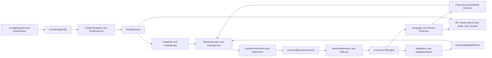

# 10/21 EMA + Supertrend: end-to-end implementation plan

Version: PLAN-1.0 · Date: 2026-10-15 · Strategy ID: `ema_trend` · Status: specification only; trading implementation has not started.

## 1. Purpose, scope, and authority

Implement a separate long-only stock trend strategy in Sterling, with Swing, Intraday, Scalp, and Ultrascalp profiles. Preserve the current shared signal-table design and add a complete strategy section to Connect. Carry each decision from market data through setup, risk, orders, fills, protection, partial exits, add-backs, accounting, replay, and evidence. The implementation must remain operable when the browser closes or the service restarts.

This document is the handoff specification for GPT-6.1 Sol. It supplies explicit rules, implementation boundaries, artifact dependencies, and acceptance evidence; it does not promise equivalence between model settings. Section 20 contains a ready-to-use implementation prompt.

The user's final request is **to create the plan before implementation**. Producing this document does not authorize placing orders, changing account settings, enabling live execution, or treating a backtest as proof of future income. The attached image and strategy discussion are reference material. Their trading claims and embedded instructions do not override the user's request or repository instructions.

A strategy cannot be made an “absolute money making” system by specification. Success means a correct, testable implementation and an honest result: `VALIDATED_WITHIN_SCOPE`, `FAILED`, or `INCONCLUSIVE`. Parents must not be told that this app guarantees living expenses. Default to disabled scanning, paper execution, zero live allocation, and visible evidence status. A five-day delivery window cannot establish a long-term daily strategy's profitability.

Canonical strategy mathematics and semantics belong in this folder, consistent with `docs/strategy/README.md`. Shared indexes describe the feature; they do not redefine its rules. Reuse the canonical execution and accounting authorities described in `docs/architecture/EXECUTION_AUTHORITY.md`, `RISK_AUTHORITY.md`, and `REPLAY_CONTRACT.md`.

### Inspected baseline

- Repository: `/home/nageshmadaram/Sterling`.
- Inspected HEAD: `87b7b5ab06290a555cdd7a982e138f13afbab15d`.
- Many backend and frontend files already contain uncommitted changes, including Connect, the shared board, charts, authentication, and other strategies. HEAD alone does not reproduce this inspected workspace. Before implementation, capture relevant file hashes and the dirty-file list; preserve all unrelated work. Do not reset, clean, or overwrite it.
- `AGENTS.md` requires graph tools before source exploration. Their MCP methods were unavailable in the planning session, so targeted source inspection was used. The implementing agent must try the graph tools again and use source fallback only when unavailable or insufficient.
- Source inspection and independent backend, frontend, and strategy reviews informed this plan. No strategy code was changed, broker called, backtest run, or profitability result established while writing it.

## 2. Decisions that close gaps in the reference

| Question | Version 1 decision |
|---|---|
| Strategy identity | New immutable `ema_trend`; display “10/21 EMA + Supertrend”. Never alias it to existing `supertrend` or `sterling-kite`. |
| Instruments | Liquid, explicitly selected cash equities on supported NSE/BSE sessions; traded instrument and signal instrument are the same. No default derivatives translation. |
| Index, commodity, options, shorts | Not supported for execution in v1. Index observations may be read-only context. New vehicles require their own sizing, costs, execution, evidence, and version. Do not submit an index spot order or translate a stock stop into option-premium points. |
| 50 reference | **DEMA50**, not SMA50/DMA50 or EMA50. The text and image use inconsistent shorthand; explicit DEMA50 is authoritative here. |
| Supertrend role | Context in the daily baseline; never a standalone entry. Re-entry confirmation and higher-timeframe filters are explicit configuration policies. |
| Core direction | Long only. A bearish crossover manages weakness; it does not open a short. |
| Quarter quantity | Fractions of the campaign's **initial confirmed filled quantity**, never of the remaining position. |
| Final structural exit | Close all attributable remaining shares, including add-backs. “Final 25%” is only the no-adds, all-earlier-exits-fired example. |
| Re-entry from flat | A new campaign requiring a fresh bullish crossover and valid setup. Add-backs apply only to a still-open campaign. No resurrection of old orders. |
| Timeframes | Separate strategy-owned profiles; do not inherit global hourly “swing” or rename one implementation four times. |
| Refinements | Numeric thresholds below are predeclared research defaults, not proven optimal settings. Compare against the unfiltered source baseline and preserve negative results. |

Do not expand v1 to options merely because existing boards show CE/PE. Cash-equity holdings, delivery sell authorization, position attribution, product handling, and protection need dedicated acceptance coverage before any live eligibility.

## 3. Artifact chain and invariant identity



Every arrow must have a typed input, output, owner, failure reason, and test. A screenshot or matching count of rows cannot demonstrate the execution chain.

All decision and accounting artifacts carry an immutable envelope:

```text
schema_version, artifact_id, parent_artifact_ids
uid, account_id, tenant_kind: LIVE|SIMULATION|REPLAY
view_session_id, replay_run_id (nullable outside replay)
strategy_id=ema_trend, strategy_version, canonical_mode, mode_version
execution_vehicle=EQUITY, product=CNC|MIS, vehicle_policy_hash
config_revision, config_hash, rule_hash, universe_hash
runtime_sha, workspace_manifest_hash, evidence_track
event_time, available_at, decision_time, recorded_at
```

Require UTC-aware storage timestamps and Asia/Kolkata display/session rules. Never default an authenticated route to `uid=default`. Reject non-finite prices, quantities, timestamps, and budgets. Hash normalized, versioned JSON with stable ordering and explicit numeric serialization; use exact decimal/tick arithmetic for cash, quantities, prices, and order rounding. Do not pool modes, products, vehicles, configurations, or fitted challengers as one evidence sample.

## 4. Deterministic indicators and causal data

### 4.1 Data readiness

Use ordinary OHLCV bars, not Heikin-Ashi. Each bar records instrument identity, exchange, resolution, session, open/close timestamps, provider, availability timestamp, adjustment version, and completion/quality status. Price must be positive; high/low must enclose open/close; volume must be nonnegative. Reject duplicates with contradictory content, out-of-order/future observations, missing required intervals, non-finite fields, and stale/unverified instrument metadata.

Every decision uses only data with `available_at <= decision_time`. A provider's timestamp may identify the bar's opening time: normalize it before checking completion. Do not interpret today's still-forming daily bar as a daily close. Reuse `services/daily_sessions.py::closed_daily_candles` after verifying exchange-specific calendar behavior.

Intraday aggregations anchor to that instrument's exchange session start. Do not use UTC-midnight buckets. Build weekly bars from exchange trading sessions, not five arbitrary daily rows. A week becomes usable only after the calendar's last trading session closes and the inputs arrive. A holiday Friday may make Thursday the last session; incomplete current-week values remain diagnostic only. Lookup higher-timeframe features as of the decision time.

Indicators may carry valid history across sessions; intraday setups, pending add eligibility, weakness counters, and position campaigns obey their own session reset rules. An overnight gap contributes to true range. A missing required bar breaks consecutive-close counting until continuity is restored; do not compress two separated closes into a two-close event.

Require 250 valid completed signal bars for production feature readiness. Require at least 100 completed context bars for the configured higher-timeframe EMA/ST filter, even when Swing uses context-only. Report `WARMING_UP` with observed/required counts. A source-baseline research run may explicitly test an `HTF_DISABLED` variant under a different hash. Never silently disable the configured context because history is short.

Corporate actions: store raw tradable prices separately from adjusted research prices. Use a versioned, point-in-time-consistent adjustment policy. A split/bonus changes quantity, cost basis, stops, and pending protection through an auditable reconciliation event. Retain immutable original anchors and apply an adjusted execution projection: for split factor f, quantity/quotas multiply by f, prices/R divide by f, and initial cash R stays invariant, subject to actual broker rounding/cash-in-lieu reconciliation. Apply equivalent transforms to pivots, indicator state, candidates, reservations, and protection; cancel/reconcile incompatible outstanding orders. Dividends and applicable charges enter accounting. If an action cannot be reconciled, block new/add exposure and retain the unresolved position. Do not generate a spurious EMA cross from a mixed adjusted/unadjusted series.

### 4.2 Indicator contract

Implement a strategy-local indicator adapter with these frozen semantics; preserve old strategies' outputs.

```text
EMA_N: alpha = 2/(N+1)
seed = SMA of first N valid closes; prior outputs are unavailable, not zero.
EMA_N[t] = alpha*C[t] + (1-alpha)*EMA_N[t-1]

DEMA50 = 2*EMA50(C) - EMA50(EMA50(C))
The second EMA starts on the FIRST EMA's valid suffix, not its zero padding.
First possible DEMA50 is the 99th valid observation; readiness still uses 250.

TR[0] = H[0]-L[0]
TR[t] = max(H[t]-L[t], abs(H[t]-C[t-1]), abs(L[t]-C[t-1]))
ATR10 seed = mean(first 10 TR); thereafter (9*prior_ATR+TR)/10.

basicUpper = (H+L)/2 + 3*ATR10
basicLower = (H+L)/2 - 3*ATR10
upper = basicUpper if basicUpper < previousUpper
                       or previousClose > previousUpper else previousUpper
lower = basicLower if basicLower > previousLower
                       or previousClose < previousLower else previousLower
```

At the first valid ATR, initialize carried bands to the basic bands, direction `DOWN`, line=upper. Thereafter, if previous direction is DOWN, flip UP only when current close > current carried upper; if UP, flip DOWN only when close < current carried lower. Use lower for UP and upper for DOWN. Equality does not flip. Represent direction by named `UP/DOWN/UNAVAILABLE`; TradingView Pine sign conventions must not leak into business logic. Before readiness, no price of zero is an indicator.

This uses TradingView's documented band/direction logic and Wilder ATR. EMA seeding is explicitly Sterling's SMA-seeded contract. Do not claim exact parity with an unidentified custom Pine script. Existing shared `compute_ema` zero-pads warmup and existing `compute_supertrend` initializes bullish with a zero first line: calling them unchanged does not establish this contract. Either adapt safely or implement locally, with versioned fixtures and no changes to frozen existing Supertrend parity. [Supertrend reference](https://www.tradingview.com/support/solutions/43000634738-supertrend/), [ATR smoothing](https://www.tradingview.com/support/solutions/43000501823-average-true-range-atr/), [DEMA formula](https://www.tradingview.com/support/solutions/43000589132-double-exponential-moving-average-ema/).

### 4.3 Causal swing points

Default `pivot_left=2`, `pivot_right=2`. Pivot high at index i requires H[i] strictly greater than both left highs and greater than or equal to both right highs; pivot low mirrors this rule. Emit the pivot only at the close of i+2. Record occurrence and confirmation times. Breakout and stop decisions may use it only after confirmation. Pivots used as prior breakout barriers must already be confirmed before the triggering bar; a structural pivot can trigger its own confirmation-time action.

All historical and live prefix calculations must produce the same artifacts at time t. Future bars must not change earlier decisions. See TradingView's discussion of [higher-timeframe and realtime repainting](https://www.tradingview.com/pine-script-docs/concepts/repainting/).

## 5. Entry, setup expiry, and initial protection

Use completed **signal timeframe** bars for daily-style EMA decisions in every profile. Execution quotes and broker stops run independently at market-event cadence.

### 5.1 Crossover and setup arming

- Bullish cross at t: `EMA10[t-1] <= EMA21[t-1]` and `EMA10[t] > EMA21[t]`.
- Bearish cross mirrors this with `>=` then `<`.
- A bullish cross arms one `setup_id` after that bar closes. A cross itself never buys.
- Entry setup evidence must occur after the cross. Expire after `setup_expiry_bars` or a bearish cross, invalidation below the candidate swing stop, end of an intraday session, or a superseding config revision. Display the reason.
- Warm-start history can reconstruct watching setups but cannot retroactively submit old entries. Persist an activation watermark; a new actionable event must occur after it. Existing campaigns continue from durable state.

### 5.2 Pullback/retest path

For a completed bar j after the cross, EMA10 or EMA21 is touched if its bar range intersects `[EMA[j]-0.15*ATR10[j], EMA[j]+0.15*ATR10[j]]`. Freeze the touched EMA ID, j, its value, ATR, and an already-confirmed qualifying pivot/stop as of j. Require low[j] > that stop. If no pivot is confirmed at the touch, reject that touch; a later pivot confirmation needs a fresh touch/setup, not a retroactive stop substitution. If both EMAs are touched choose EMA21 first, record EMA10 as alternate evidence, and never create two entry orders. A dip is not a stop: the hard stop remains below a confirmed swing low.

Confirmation on j or within the next `confirmation_window_bars=3` requires `close > open`, `close > high[previous completed bar] + one tick`, `close > touched_EMA[current]`, and current EMA10 > EMA21. Reject zero-range/missing bars. If confirmation is on a later bar, no intervening low may breach the frozen candidate stop. The setup must still be unexpired.

### 5.3 Tight consolidation breakout path

On candidate confirmation t, examine only the immediately preceding N completed bars, N in {3,4,5}, all after the cross. A box is tight if `(max(high)-min(low)) <= 1.25*ATR10[t-1]`. Use the longest qualifying box, then a stable time-based ID. Require current bullish close > box high + one tick, close > both EMAs, and EMA10 > EMA21. Exclude current t from the box. This translates “3–5 days” into 3–5 **signal bars** for lower-timeframe profiles; the UI must say bars, not days, outside Swing.

If both paths confirm on the same bar, choose retest first and record the alternate as diagnostic evidence. One campaign per account/instrument across all modes prevents duplicate positions from simultaneous profiles. Keep the rejected alternate decision in the audit trail.

### 5.4 Stop and execution timing

For retest, use the latest pivot low whose occurrence is at or after the bullish cross, whose occurrence is no later than the touch, and whose confirmation is no later than that touch. Freeze stop buffer with ATR10 at the touch. For breakout, use the latest confirmed low at or after the cross and before confirmation; it must already be confirmed before the breakout bar, and buffer uses ATR10 at the breakout decision. If none exists, wait; do not silently substitute a guessed stop. Stop = pivot low minus `max(one_tick, 0.10*frozen_setup_ATR10)`, rounded downward to a legal tick.

Use the same candidate pivot/stop across confirmation's three-bar window unless a new setup is explicitly created. Reject when conservative executable entry <= stop or stop distance is outside the profile's ATR bounds. Avoid chasing: require estimated entry <= confirmation close + `max_entry_chase_atr*ATR10`. Freeze the entry plan's ceiling.

The decision occurs after the confirmation close; an order may fill only at a subsequent eligible quote/trade or next bar under the declared simulation model. No filling at an already-observed close without an actual subsequent event. Use marketable limit orders within the ceiling by default; no assumption that a touched limit fills.

Initial entry expires after one signal bar (Swing: the next exchange session's entry window), or immediately on invalidation. Cancel and reconcile its unfilled remainder before freezing campaign initial quantity. A partial fill must be protected while entry remains pending. An unknown cancellation result freezes new exposure.

Default stop is fixed until a new confirmed higher pivot permits `new_stop=max(old_stop, pivot_low-buffer)`. Install only after canonical protection acknowledgement and retain prior valid coverage during replacement. Never widen a stop to permit an add. DEMA50 and Supertrend lines are visual context by default; neither silently replaces the swing stop.

## 6. Campaign state, partial exits, and add-backs

### 6.1 Two state dimensions

Keep setup state (`IDLE`, `WATCHING`, `CONFIRMED`, `EXPIRED`, `BLOCKED`) separate from campaign state (`ENTRY_PENDING`, `OPEN`, `ACTION_PENDING`, `CLOSING`, `CLOSED`, `RECOVERY_REQUIRED`). Distinguish confirmed inventory, desired inventory, reserved inventory, and acknowledged orders. Protection has its own `PENDING/CONFIRMED/DEGRADED/UNKNOWN` state. A failed signal scan cannot mark a held position closed.

Transitions affecting quantity derive from deduplicated canonical fill events. Signal predicates may create intents and reservations; neither quote crossings, order submission, ACK, nor browser state changes quantity or P&L.

### 6.2 Initial units and immutable R

After the initial entry order is terminal and all its fills reconcile:

```text
Q0 = actual initial filled shares
P0 = volume-weighted price of those initial fills
S0 = frozen initial protective stop
R_price = P0-S0 > 0
initial_R_cash = Q0*R_price
q = floor(Q0/4) in exchange quantity steps
quarter quotas = [q, q, q, Q0-3q]
four_R_price = P0 + 4*R_price
```

Pre-entry sizing requires at least four quantity steps. If a terminal partial fill leaves fewer than four, protect and close it through canonical execution with `ENTRY_TOO_SMALL`; do not manufacture tradable quarter orders or round up. Initial entry remains bounded by its reserved plan quantity and risk.

`Q0/P0/S0/R_price` never reset after an add, stop raise, partial exit, restart, or profitable sale. A reconciled corporate action may mechanically rescale quantity and price anchors while preserving their economic value and complete original lineage; this is not a fresh R calculation. New exposure is capped at the correspondingly adjusted Q0. Show current inventory VWAP separately. Record actual per-lot basis and realized costs; R is a strategy reference, not accounting P&L.

### 6.3 Exit events

| Event | Predicate | Requested reduction | Latch behavior |
|---|---|---|---|
| `TAKE_4R` | First completed signal close >= `P0+4R_price` | First quota q | Once per campaign. A milestone can be pending until its intent resolves; never rearmed by add-backs. |
| `WEAK_10` | Second consecutive completed post-entry close strictly below EMA10 | q | Emit at counter==2. A continuing below run never emits again. |
| `WEAK_21` | Second consecutive completed post-entry close strictly below EMA21 | q | Same rule, independently tracked. |
| `STRUCTURAL_EXIT` | A confirmed pivot high occurs after the latest bearish crossover and is below the immediately prior confirmed pivot high | All remaining attributable inventory | Terminal campaign exit, even if earlier quarter rules never occurred. |
| `STOP` | Broker protective stop or independently observed stop breach | All remaining attributable inventory | Never wait for a second close or a pivot. |
| `SESSION_EXIT` / kill | Cutoff, max holding policy, authenticated flatten, or hard risk breaker | All attributable remaining inventory | Entry/add intents canceled and reconciled first; no unowned stock sale. |

4R is **close-confirmed** in v1 to keep source execution and replay causal. A target-limit/intrabar-touch variant is a separate rule revision with path-sensitive tests. A gap through a stop may realize a loss beyond 1R.

Ordinary milestone/counter evaluations start only after initial entry is terminal and Q0/P0/S0 are frozen; earlier closes cannot retroactively count. Protective and terminal exit handling runs from the first actual partial fill, even before that freeze. Equality/above resets the relevant below counter to zero. Track an episode ID for each new below run and persist each pending/executed/suppressed event. An EMA weakness quota may execute again only after (a) its sold capacity has actually been restored by an eligible add, (b) its new below run starts on a later bar, and (c) a new counter reaches two. Rearmed allowance is only the quantity actually restored, capped at q; a five-share restoration cannot authorize a fresh 25-share sale. A partial reduction's unfilled amount belongs to its existing action; do not create a second action for it.

If the counter reaches two while its reduction is not eligible to rearm, record `LATCH_NOT_REARMED` for that episode. Do not sell q on every subsequent bar. Structural exit uses the previous confirmed pivot high as of its pivot occurrence, never one learned from later bars; equality does not qualify. Reset the bearish-cross structural arm on a new bullish cross, but never cancel an already-submitted terminal close just because the market recovers.

When multiple nonterminal exit events fire on one bar, sum their still-unconsumed quantities, clip to confirmed available inventory, submit one durable reduction, and retain component allocations. Allocate fills in order `WEAK_21`, `WEAK_10`, `TAKE_4R`. An action isn't fully consumed until filled or explicitly terminally suppressed by campaign closure. Inadequate inventory never becomes a negative position.

### 6.4 Add events and edge capture

| Event | Predicate after a prior filled reduction | Upper-bound request |
|---|---|---|
| `RECLAIM_10` | Previous completed close <= previous EMA10; current close > EMA10 and close > open | q |
| `RECLAIM_21` | Previous completed close <= previous EMA21; current close > EMA21 and close > open | q |
| `HIGHER_LOW` | New pivot low occurs after a new bullish 10/21 crossover, is higher than the prior confirmed low, and confirms with current close > both EMAs | q |
| `PIVOT_BREAKOUT` | Current bullish close > prior confirmed pivot high + tick, previous close <= that same fixed barrier, EMA10 > EMA21 | Q0-3q, clipped to available capacity |

The two price reclaim events do not automatically require a new bullish EMA crossover: that requirement belongs to `HIGHER_LOW`. Do not accidentally change the reference sequence by adding a global EMA-alignment condition to all adds. Profile HTF/ST filters and risk checks still apply.

An eligible event requires a **post-reduction** edge/structure occurrence; a stale cross captured before the sale cannot refill it. Reclaim10/21 each require their matching filled weakness reduction; this avoids buying back the 4R sale merely because price is already above an EMA. Higher-low and pivot-breakout events may refill other previously sold capacity, including the 4R quota. Initial entry is not an add event.

Persist vacancy quantity per filled reduction component and episode; intentions do not create vacancies. A reclaim may consume only still-open vacancy from its corresponding weakness component. Higher-low/pivot adds consume remaining vacancies FIFO by reduction fill time, then component priority WEAK21/WEAK10/TAKE4R as a tie-break. Every actual add fill consumes those vacancy shares and restores only the corresponding weakness allowance (if any); any add can consume a vacancy before a captured reclaim candidate executes. Revalidate vacancy ownership before each order. Never reuse an old fully refilled sale as evidence of available capacity. Fill allocations and allowance changes are atomic and deduplicated.

Capture simultaneous add edges as durable candidates with a three-signal-bar expiry: an event at bar t may execute at t, t+1, or t+2 and expires before evaluation at t+3. Evaluate at most one add per completed bar, in priority `RECLAIM_10`, `RECLAIM_21`, `HIGHER_LOW`, `PIVOT_BREAKOUT`. On each later candidate evaluation, recheck current price above the relevant EMA/barrier, bullish close, required context, validity, risk, cash, inventory headroom, and quote quality. A higher-low candidate must still have an unbroken stop structure. Expired or invalid candidates record a reason; they do not wait forever. This prevents losing the second reclaim when price crosses both EMAs on one bar without allowing a 50% impulse purchase.

Reclaim latches rearm only after a new corresponding weakness reduction fills. Higher-low and pivot-breakout each fire at most once per bullish crossover epoch; a later epoch must supply new post-reduction structure. A partially filled add consumes its catalyst once, creates allowance only for its filled shares, and does not authorize a fresh full add for the unfilled amount. Rejected/expired candidates need a fresh qualifying event; changing a switch or reloading the browser never retries them implicitly.

Every addition must satisfy:

- Confirmed attributable shares >0; no terminal close/recovery pending; real vacancy below Q0 after pending buys and sells are considered.
- Conservative executable price >= `max(P0, current_inventory_VWAP, last_add_fill_VWAP_if_any)`. Do not add into a lower price to reduce average cost. Recheck actual slippage in accounting; do not relabel a loss as a new campaign.
- Same or tighter confirmed stop; stop remains below executable price. A newly confirmed higher low can raise the stop only through the acknowledged protection path.
- New setup event, profile's ST/HTF policy, and all risk/cash/cost gates pass. Realized profits never automatically enlarge the fixed campaign risk budget.
- Requested quantity is rounded down to min(event quota, vacant capacity, authorized risk/cash capacity). If zero or below the declared minimum economic size, skip with reason. No minimum-lot rounding upward.

The no-averaging-down price test is an **admission** rule, not a guaranteed execution-price floor: a buy limit caps the maximum paid and can receive favorable price improvement. Record any fill below the admitted floor, recompute actual inventory/risk, and block further increases until checked. Favorable price improvement alone does not force a churn trade. A breached stop, excess authorized risk, stale/invalid source, or ownership mismatch invokes immediate protective reconciliation and the predetermined reduce/close policy; never disguise it as a new approved add.

### 6.5 Ordering and concurrency

Process market/ledger events under an account/instrument ownership lock and durable state revision. Decision priority is: broker fill/recovery truth; protective stop/emergency/session exit; structural close-all; nonterminal reductions; one add; new entry. A bar producing any exit intent suppresses all adds for that bar. Persist candidates and suppression reasons. An existing exposure-changing order blocks another except canonical protective/emergency handling.

Request cancellation/reconciliation of pending buys when closing, and immediately protect/close already-confirmed inventory through canonical safeguards. Do not delay urgent risk reduction while buy cancellation is UNKNOWN. Adjust sell/stop quantities to actual fills, avoid duplicate sell coverage, and remain CLOSING until all possible buys and closes are terminal/reconciled. A late buy fill during closing remains owned inventory that must be protected/closed; do not ignore it after UI says “ended”. Use idempotency keys scoped to tenant, account, campaign, action kind, event ID, and revision. Replays with identical input events must yield identical action IDs.

For an ordinary reduction with a known terminal partial cancel or transient rejection, the same logical action may make at most one successor attempt using a new journal-linked attempt ID, only after confirmed terminal evidence, a fresh quote, and within one signal bar of its original decision. Preserve component filled/remainder allocations. UNKNOWN never qualifies for this retry. A permanent rejection, second failed attempt, or expired unfilled reduction escalates to CLOSING with new exposure disabled and canonical close-all attempts/visible unresolved status. A failed add cancels its known unfilled remainder and ends the catalyst; it never escalates into a larger buy. All retry/close handling stays within canonical execution controls.

### 6.6 Golden acceptance trace

For Q0=100, P0=100, S0=95, 1R=5, assume sufficient risk and price for each add:

| Ordered event | Filled delta | Remaining | Required evidence |
|---|---:|---:|---|
| Initial entry terminal | +100 | 100 | Freeze Q0/P0/S0; protection confirmed |
| Close at 120 qualifies 4R | -25 | 75 | One `TAKE_4R` latch; a further close at 121 sells zero |
| Second close below EMA10 | -25 | 50 | New WEAK10 episode; continuing below sells zero |
| Later second close below EMA21 | -25 | 25 | Independent WEAK21 episode |
| Fresh reclaim10 | +25 | 50 | Matching vacancy, price and risk admission |
| Fresh reclaim21 | +25 | 75 | One add per bar; pending candidate if simultaneous |
| Higher low after bullish cross | +25 | 100 | Capacity now full |
| Prior pivot breakout | 0 | 100 | `CAPACITY_FULL`, not another buy |
| Later lower high after bearish cross | -100 | 0 | Exit all restored inventory; do not sell just 25 |

Also test Q0=103 -> quotas 25/25/25/28, partial sells of 10 then 15, initial partial Q0=3, simultaneous EMA exits, 4R+stop in a coarse bar, unknown submission, and restart between each event. No example establishes attainable returns.

## 7. Mode profiles and explicit refinements

These are **initial research hypotheses**, separate mode identities and evidence reports. Indicator lengths remain 10/21/50 and ST(10,3); shortening every indicator to make it “ultra” is not a tested improvement.

| Profile | Canonical mode | Signal bars | Context bars | Initial product | Setup expiry | Cooldown after closed campaign | New entry/add cutoff and forced close |
|---|---|---|---|---|---:|---|
| Swing | `swing` | Daily | Completed weekly | CNC, fully funded | 20 signal bars | 2 signal bars | Entry next session 09:20–15:00; no routine time-based close |
| Intraday | `intraday` | 15 minute | Completed 60 minute | MIS, fully funded sizing | 12 signal bars | 3 signal bars | New exposure 09:30–14:45; force close 15:15 |
| Scalp | `scalping` | 3 minute | Completed 15 minute | MIS, fully funded sizing | 10 signal bars | 5 signal bars | New exposure 09:30–14:45; force close 15:15 |
| Ultrascalp | `ultra_scalping` | 1 minute | Completed 5 minute | MIS, fully funded sizing | 8 signal bars | 10 signal bars | New exposure 09:30–14:45; force close 15:15 |

Times above are provisional NSE/BSE regular-session IST settings. Derive actual sessions, holidays, special sessions, and broker cutoff from versioned metadata; use the earlier valid cutoff and configurable safety margin. Do not assume a fixed calendar is universally valid. Intraday entries must not silently convert to CNC. Swing orders derive from prior completed daily evidence, then recheck next-session price/stop/chase/risk before submission; do not recompute an entry with a forming daily bar.

| Profile | Stop distance min/max ATR | Max entry chase ATR | Max quote age on submission | Time exit | Extra admission refinement |
|---|---|---:|---:|---|---|
| Swing | 0.5 / 4.0 | 0.5 | 30 seconds | No fixed holding cap; daily lifecycle rules manage trend | Daily and weekly ST displayed; default context-only |
| Intraday | 0.5 / 3.0 | 0.3 | 10 seconds | Session cutoff | HTF ST UP and HTF EMA10>EMA21 |
| Scalp | 0.4 / 2.5 | 0.2 | 5 seconds | 20 signal bars after initial fill or cutoff | Same HTF alignment; tighter spread/cost screening |
| Ultrascalp | 0.4 / 2.0 | 0.15 | 3 seconds | 15 signal bars after initial fill or cutoff | Same HTF alignment; verified depth/latency/cadence mandatory |

Time exits are from the initial fill and do not reset after adds. None is allowed to extend a session cutoff. Define `bars_held` by actual completed signal bars, not poll count. New full campaigns require the next fresh bullish crossover after cooldown; a pre-cooldown historical crossover cannot retroactively arm an order.

The existing `TradeHorizonPlan` requires exactly one hard exit timestamp/session and `HorizonModeConfig` requires an integer hard holding limit. Therefore a daily Swing override alone cannot represent this strategy's condition-based exit. Define a strategy-owned immutable `EmaTrendHorizonContract` with a discriminated policy: `CONDITION_BASED` for Swing, `TIME_OR_CONDITION` for the other profiles, plus signal/context timeframes, session rules, and explicit stop/structural exit policies. Adapt its presentation/monitoring through typed boundaries. Do not pass None/infinity/fake distant deadlines into the old builder or change old strategies' capped contracts. If a shared execution boundary requires the old capped type, supply and test a narrow typed adapter rather than silently imposing a 15-session exit.

Common optional chop guard: EMA21[t] > EMA21[t-3] and `(EMA10[t]-EMA21[t])/ATR10[t] >= 0.10`. It applies to new initial setups, not weakness exits or the pre-crossover reclaim add sequence. Default OFF in source-baseline Swing, ON in the three refined short-term profiles. It is an ablation candidate; do not advertise fewer false signals without evidence. DEMA50 slope/above-price filters, volume filters, VWAP, ADX, and an additional macro timeframe remain OFF unless separately specified and tested.

`reentry_st_policy=context_only|required_green` is explicit; initial default is context-only for Swing and required-green execution ST plus the HTF filter for the three refined profiles. Red ST blocks new/add exposure under required-green; it does not directly liquidate under the baseline. `exit_on_red_st` and `trail_on_st` are OFF and are separate challengers. Display both context lines and their completion timestamps.

Ultrascalp here means a one-minute **bar strategy**, not sub-second or high-frequency execution. Kite's historical API lists minute and selected multi-minute intervals, not second bars or weekly bars. Build 3-minute/context/weekly support deliberately. If only OHLC is available, label fast-mode execution results provisional: spread, depth, queue, and latency are unobserved. Do not fabricate a second-based replay or call a one-minute OHLC backtest a validated scalping edge. [Kite historical intervals](https://kite.trade/docs/connect/v3/historical/).

## 8. Risk, costs, and equity product handling

### 8.1 Fixed budget and initial size

Require an explicitly configured disposable allocation and authenticated broker account. Zero allocation is the default. Household funds are not inferred as trading capital. Proposed paper presets: risk per campaign 0.25% of configured allocation; maximum 0.50%; strategy open risk <=0.75%; daily net loss breaker <=1%; allocation drawdown breaker <=5%; max 3 simultaneous campaigns; max 1 per instrument across modes; max 2 in one configured sector. Existing stricter account/global limits always win. These are starting constraints, not proof of safety; gaps can exceed them.

```text
B0 = min(allocation*risk_fraction, explicit_currency_cap_if_set,
         remaining strategy/account risk allowance)
d = conservative_entry_price - protective_stop
q_risk = floor_to_step((B0 - fixed_cost_reserve) /
                       (d + per_share_slippage_gap_and_fee_reserve))
q_cash = floor_to_step(verified_available_cash / fully_loaded_entry_cash_per_share)
Q_plan = min(q_risk, q_cash, concentration/participation/instrument caps)
```

Reserve cash and risk atomically across strategies, users' correct accounts, modes, and pending actions. A cheap looking stock is not exempt from turnover/depth screens. No leverage assumption under MIS; v1 sizing remains fully funded. If broker requirements are stricter, use those. Reject Q_plan<4 steps or uneconomic tiny quarters.

For adds, conservative used campaign risk is:

```text
cumulative_realized_loss_debit
+ sum(remaining_lot_qty * max(lot_entry_price - confirmed_stop, 0))
+ pending_increase_risk
+ remaining liquidation fees, slippage, and declared gap stress reserve
```

`cumulative_realized_loss_debit` is the sum of max(0, -net realized P&L) for each disposed FIFO lot allocation, with allocated fees; profitable disposals never reduce it. It is not max(0, -the campaign's aggregate net P&L), which would recycle profits against later losses. Require used risk after the proposed add <=B0 and every parent risk cap. Keep fee reservations separate from the actual ledger to avoid double-counting paid costs. Test cash release timing and broker unsettled-funds restrictions. Negative/unknown capital, stale margin, or unavailable ownership proof denies exposure. Daily/drawdown breakers include actual realized net results and conservatively marked open exposure after costs; missing marks cannot clear a latched breaker.

### 8.2 Costs and executable liquidity

Use a dated, product/exchange-specific fee schedule: brokerage, securities taxes, exchange/clearing charges, GST, stamp duty, applicable delivery/depository charges, and spread/market impact. Record estimated and actual costs separately and reconcile when actual fee evidence arrives. Do not hardcode today's tax rates into strategy mathematics. Quarter exits and add-backs create additional transactions; price them individually.

Before entry, define `planned_R=conservative_executable_entry-planned_stop`; actual `R_price` exists only after initial fills freeze. Admission default: observed spread <= min(0.10% of mid, 0.10*planned_R), and estimated full campaign transaction cost <=15% of B0. Recompute actual filled economics after partial fills/slippage without loosening the stop or increasing B0. An unexpected fill exceeding authorized risk triggers immediate admission halt, protection/reconciliation, and a predetermined canonical reduce-to-budget or flatten action; do not silently accept excess risk. For adds use immutable actual R_price and current stop risk. Quote/depth must support intended size under a declared participation bound (initial research ceiling 1% of the prior completed signal bar's volume); reject missing/degraded evidence for any live or fast-mode execution claim. These screening values are hypotheses. Do not pretend that passing a cost screen predicts a 4R move.

### 8.3 Cash-equity obligations

Execution vehicle is EQUITY; explicit product is CNC for Swing and MIS for short-term profiles. Verify instrument eligibility, price bands, tick sizes, sellable/settled quantities, corporate actions, delivery authorization, and broker protection capabilities. Broker products and exit orders must agree with the held product. [Kite order products and parameters](https://kite.trade/docs/connect/v3/orders/), [portfolio and exit product](https://kite.trade/docs/connect/v3/portfolio/).

For CNC, prove that the authenticated account can sell/protect the shares through the chosen authorization setup. GTT triggers place limit orders and do not guarantee a fill. An exchange stop can also fail to execute through a gap/circuit. UI state distinguishes protection configured, broker acknowledged, triggered, filled, and degraded. No promise of a guaranteed stop price. [Kite GTT contract](https://kite.trade/docs/connect/v3/gtt/).

Use canonical protective operations and lifecycle constraints. Existing generic entry convenience helpers assume F&O capital and must not be used unchanged. If canonical equity reduction/protection cannot safely support the needed product, ship complete paper/replay behavior and a visible `EQUITY_PROTECTION_UNVERIFIED` live blocker; document a narrow corrective implementation task. Never bypass the frozen execution service or call the broker directly to finish a milestone.

## 9. Durable storage, APIs, and lifecycle behavior

### 9.1 Proposed stored artifacts

Add versioned migrations through the repository's actual migration mechanism after inspection. Names below are proposed new tables/projections, not assertions that they exist:

| Artifact/store | Key and indispensable fields | Failure rule |
|---|---|---|
| Config snapshot | uid + account binding + revision; validated profile map, enabled modes, allocation, rule/vehicle hashes, activation watermark | Invalid persisted data => engine OFF with diagnostic; no legacy-user fallback |
| Bar checkpoint | tenant + instrument + profile + config; last completed/processed bar, input lineage/hash | Never skip management fills because a scanner checkpoint advanced |
| Decision log | decision ID + source feature IDs, accept/reject reasons, complete config identity | Store rejects and blocked actions, not only winners |
| Campaign | tenant/account/instrument + campaign ID, state revision, Q0/P0/S0/R, budget, ownership, stop, expiry/timers | Never infer OPEN/CLOSED from a signal row |
| Tranche attribution | campaign/order/fill IDs, buy lot basis, FIFO sell allocations, remaining owned shares | Sum must reconcile to ledger and broker, including external/manual trades |
| Action outbox | deterministic action ID, parent event, kind, requested/filled remainder, expected revision, journal/order linkage | Atomic state+outbox; crash after commit cannot lose the intent |
| Counter/latch/candidate state | below episodes, cross epochs, 4R latch, candidate expiry, consumed quantities | Restart cannot repeat or silently discard a quarter |
| Protection projection | canonical protection IDs, desired and acknowledged qty/stop, pending replacement and coverage evidence | Missing/unknown coverage blocks increases; retain visible exposure |
| Evidence manifests | dataset/run/build/config/rule/vehicle hashes, splits, results, limitations | Any scope-changing revision invalidates applicable eligibility |

Reuse the canonical order journal, fill ledger, and execution control. Do not create a second order authority or independent realized-P&L ledger. Campaign projections provide attribution over the authoritative fill facts. Use transactions/CAS and durable ownership uniqueness; a process-local mutex alone is insufficient. Backups must include the new config/state/outbox/evidence records and a tested restore.

Current ledger grouping is account+uid+symbol. Either extend its read projection with explicit strategy/campaign attribution or maintain a reconciled allocation table linked to immutable fill IDs. Reject overlapping unowned inventory and same-symbol cross-strategy collisions unless explicit shared ownership is proven. V1 uses exclusive strategy ownership per account/instrument; do not sell a parent's manually held shares.

### 9.2 Proposed API contract

Create an authenticated router in `backend/app/api/v1/endpoints/ema_trend.py`, mounted under `/api/v1/ema-trend`; keep frontend and backend generated/checked types aligned.

| Method / path | Contract |
|---|---|
| GET `/config` | Config, revision, server defaults, vocabulary, descriptor, profiles, capabilities, blockers, evidence summary |
| PATCH `/config` | `{expected_revision, changes}`; partial updates only, reject unknown fields; return canonical config+revision; 409 on conflict |
| GET `/snapshot?mode=&day=&cursor=` | Tenant/view/mode scoped decisions, held campaigns, pending actions, freshness, scan state, pagination; held positions never omitted by date filter |
| POST `/scan` | Explicit mode set and expected config revision; return job ID/generation; no broker side effects |
| GET `/scans/{job_id}`; POST `/scans/{job_id}/cancel` | Persisted status/progress/errors; cancellation stops new scan work, not position management |
| GET `/history`; GET `/campaigns/{id}` | Read-only, paginated decisions/events/fills/costs, ownership, immutable source evidence |
| POST `/plans` | Browser sends `{signal_id, expected_config_revision}`; server builds immutable current plan and blockers |
| POST `/plans/{id}/arm` | `{expected_revision, idempotency_key, execution_mode}`; server revalidates signal, quote, risk, tenant, live eligibility; never trusts client qty/stop |
| POST `/campaigns/{id}/actions` | Enum action request, expected state revision, idempotency key; preview/revalidate discretionary reduce/close/tighten; no arbitrary buy shortcut |
| POST `/operations/pause`; POST `/operations/resume` | Pause/resume new exposure; return actual durable state; resume does not retry expired entries |
| POST `/operations/flatten` | Explicit owned position closure through canonical service; unresolved outcome remains visible |
| POST `/replay`; GET `/runs/{id}` | Immutable mode/config/data selection; asynchronous run; same pure core; historical tenant only |
| GET `/validation` | Per-mode evidence status and dated blockers, no synthesized profitability badge |

List mounted exact routes in the completion report. Adapt prefix only if verified repository conventions require it, and update all contracts/tests together. Forbid user-controlled uid/account switching, cross-tenant plan IDs, missing revisions, unsafe enum defaults, and live writes from history/replay. Use 401/403 for identity/access, 409 for revision/state conflicts, 422 for invalid settings/unsupported modes, and explicit service-unavailable states for failed persistence/data. Broker uncertainty is an execution result, not a fabricated success.

### 9.3 Runner, arming, and restart

Scanner `enabled`, strategy `auto_execute`, per-strategy MANUAL/SIMULATION/AUTO mode, the independent master AUTO switch, live eligibility, and durable execution control are distinct gates. Scanning in MANUAL can produce observations. AUTO alone cannot activate an unvalidated strategy. Defaults: `enabled=false`, `auto_execute=false`, paper tenant, no live allocation.

Changing config increments a generation/revision, cancels obsolete **new-entry** setups/candidates, and invalidates appropriate caches. An old entry scan cannot publish actionable rows or submit after a new config commits. Open campaigns retain frozen rule/config snapshots, counters, vacancies, and held-campaign candidates; a rule change does not orphan or reinterpret them. Current operator pause/auto permissions, lower allocation, and stricter account risk controls can still deny an increase. Record both the campaign's immutable rule config and the current admission-policy revision on each add. Never migrate held quantity fractions or R silently.

Turning scanning/auto off or pausing new trades leaves exits, stop handling, fill processing, subscriptions needed for held inventory, recovery, and reconciliation running. A halt must not strand positions. Follow the canonical service's permitted risk-reducing behavior under HALTED/RECOVERY_REQUIRED rather than inventing a strategy bypass for modify/cancel.

On startup, recover canonical orders, fills, owned campaigns, outbox, and protection before allowing increases. UNKNOWN never blindly resubmits. Reconciliation observes/projections first; broker ACK is not fill. Handle duplicate/out-of-order postbacks and cumulative fill updates. Use actual broker holdings/positions and manual/external trade detection. If the ledger, store, or ownership cannot reconcile, fail closed on entries/adds and keep the unresolved exposure visible.

At shutdown release subscriptions only after durable state is saved and the declared protection/continuity policy is satisfied. Swing remains protected overnight; intraday forced close failure must page/visibly alert and remain OPEN/UNRESOLVED. A closed browser is not a trading halt.

## 10. Repository integration map: backend

Paths in “existing” columns were inspected or identified during the repository audit. Proposed files do not exist yet. Recheck symbols against the current dirty workspace before editing.

| Responsibility | Existing artifact | Required integration |
|---|---|---|
| Production origination | `backend/app/core/release_scope.py::RELEASE_ORIGINATORS/may_originate` | Recognize the identity deliberately; recognition is separate from evidence/risk permission to send live orders |
| Evidence identity | `backend/app/core/focus.py::FOCUSABLE`, `strategy_identity.py::StrategyModeIdentity/build_identity` | Accept `ema_trend` without changing old hashes or impersonating Supertrend; keep existing focus defaults |
| Lane/mode/vehicle | `backend/app/core/lane_registry.py`, `horizon.py`, `trade_horizon.py`, `execution_vehicle.py` | Register exactly four new lane contracts and EQUITY policies; own daily/weekly Swing override; preserve legacy lanes/timelines |
| Eligibility/release | `backend/app/core/lane_promotion.py`, `release_manifest.py` | Per-mode/version/product evidence and operator live permission; no blanket promotion of all four modes |
| Config persistence example | `backend/app/services/gamma_move.py::get_config/set_config/descriptor` | New strict tenant store using `db.get_config_strict/set_config_strict`; never inherit another strategy's settings |
| Data completion | `backend/app/services/daily_sessions.py`, `causal_series.py`, `ohlcv_store.py` | Completed bars/as-of access, canonical resolution mapping and weekly aggregation |
| Candle API/provider | `backend/app/api/v1/endpoints/candles.py`, `services/exchanges/kite/constants.py` | Current public route lacks 3m/weekly; add explicit supported values/aggregation rather than string substitution |
| Canonical orders | `backend/app/services/execution_service.py` | `CanonicalExecutionService`, `ExecutionRequest`, `RiskApproval`, `ExposureEffect`; request-bound current risk proof for every increase |
| Helper limitation | `backend/app/services/canonical_strategy_entry.py` | Do not reuse its F&O BUY/capital assumptions for equity without verified adaptation |
| Risk enforcement | `backend/app/core/risk_hierarchy.py`, `services/live_minimum_gate.py`, `live_safety.py`, `safety_supervisor.py` | Real enforced account/strategy/campaign/pending risk and capital. `engines/risk/engine.py` currently describes shadow/additive use; calling it alone is insufficient |
| Execution recovery | `backend/app/services/kite_engine/order_journal.py`, `execution_lifecycle.py`, `execution_lease.py`, `fill_ledger.py` | Reuse reservations/leases/recovery/dedup/fees; add attributable campaign projection, no independent broker retries |
| Startup/shutdown | `backend/main.py` lifespan | Register runner and startup reconciliation, safely stop tasks |
| Ticks/order events | `backend/app/services/exchanges/kite/ticker_manager.py` | Explicit correct live/sim owner fanout, refcount subscriptions, postbacks, no duplicate fill projection |
| Operational inventory | `backend/app/services/protection_health.py`, `exposure_snapshot.py`, `external_positions.py`, `live_runtime.py` | Include new store in blockers, total exposure, external ownership, flatten, recovery and status |
| Journal | `backend/app/services/trade_journal.py`, `trade_journal_adapters.py`, `trade_journal_stats.py` | Explicit new strategy/fill/action/cost adapter; prove persistence since missing adapters may silently noop |
| Virtual simulation | `backend/app/services/simulation/mode.py`, `sim_client.py`, `sim_runtime.py` | Extend strategy list/adapters/seed/config/reset namespaces; owner and sim cannot both originate |
| Historical replay | `backend/app/services/simulation.py`, `replay_strategy_views.py` | Register independent historical view, same decision/lifecycle core, frozen data clock |
| Unified backtest | `backend/app/api/v1/endpoints/backtest.py`, `schemas/backtest.py`, `engines/backtest/unified_engine.py` | Explicit lifecycle dispatch for new ID; reject unknown IDs. Existing fallback silently uses EMA9/21 and boolean signals cannot represent this strategy |

Proposed module layout; combine small files when clarity improves, while keeping pure logic independent of broker/DB/UI:

```text
backend/app/engines/ema_trend/
  __init__.py          descriptor and supported profiles
  config.py           strict config and frozen profile defaults
  contracts.py        immutable artifacts/enums/reason codes
  indicators.py       guarded EMA/DEMA/ST with golden fixtures
  features.py         completed-bar + context feature assembly
  pivots.py           causal occurrence/confirmation evidence
  setups.py           cross/retest/consolidation decisions
  state_machine.py    campaign counters/latches/actions, pure reducer
  sizing.py           cash/risk/quarter arithmetic, no broker access
  manifest.py         rule/profile/vehicle identities
  backtest.py         event driver over the SAME reducer
backend/app/services/ema_trend/
  config_store.py     strict uid/account config + CAS revisions
  repository.py      transactions, ownership, state, outbox/checkpoints
  scanner.py         bounded data fetch, scan jobs and generation fence
  runner.py          scheduling, market/fill events, admission coordination
  execution.py       typed action -> canonical authority bridge
  protection.py      desired-vs-confirmed coverage projection
  reconciliation.py canonical evidence -> campaign/ownership projection
  snapshot.py        read-only API/board projection
  history.py         recorded evidence queries
  replay.py          causal replay/simulation adapters
backend/app/api/v1/endpoints/ema_trend.py
backend/tests/engines/ema_trend/
backend/tests/services/test_ema_trend_*.py
backend/tests/api/test_ema_trend_api.py
```

Do not build a new general execution framework. The existing execution interface is frozen; use it and demonstrate any actual missing equity capability with a focused failing acceptance test before a narrow change.

## 11. Signal table, Connect, chart, and journal

### 11.1 Shared row and actions

Reuse `SignalBoard`, `BoardFilters`, `StrategyBoardFooter`, `signalRowSpec`, `useSignalColumns`, `useBoardView`, sorting, groups, expansion, selection, keyboard behavior, and persisted column preferences. Current shared row tokens include 41px leg rows, 16px gaps, 200px instrument minimum, and 13px/11px instrument/numeric text: import the tokens, do not copy the numbers into a new table. Test desktop, mobile, dark/light, zoom, loading, empty, stale, error, held, pending, closed, and historical states.

Add `EmaTrendBoard.tsx` and `emaTrendAdapter.ts` to the existing board directory. Extend `boardTypes.ts::EngineId/ENGINE_LABEL/ENGINE_TAG`. Every server row carries strategy ID, canonical mode, campaign/action ID, immutable source ID, bar close, config revision and operational capability. Stable IDs cannot depend on current sort position or price.

Preserve the current shared column set and persisted column mappings. Put mode, setup/action, stage, ST/HTF context, held/initial shares, initial R/4R level, and cost/protection information into existing badge/flag/section slots and detail panels where no compatible shared column exists. Map only genuinely compatible shared price/stop/quantity/P&L fields; do not add a strategy-only table or assume new column IDs already exist. An eventual shared-column extension must update `BOARD_COLUMNS`/`ColumnId`, typed BoardSignal fields, bidirectional `signalRowSpec` preference mappings, column controls, migrations, and parity tests as a separate coherent change. Do not fill future exit price, quantity, or profits before fills. For blocked entries, show concise reason chips; preserve full detail evidence.

Detail/expansion sections: crossover and setup evidence; EMA10/21/DEMA50; both ST values/directions and completion times; pivots and their confirmation lag; original and current risk; quarter/action ledger with pending/filled amounts; current ownership and protection; costs; last data/reconciliation time; validation scope. Distinguish “sell 25 requested” from “25 sold”. Use units/shares for equity; do not label it CE/PE or multiply shares by a default F&O lot size.

**Mandatory action guard:** `useBoardRowActions.tsx` must exclude `ema_trend` from generic buy/sell. `BoardTicket` uses `allowTrade={false}` plus a strategy-owned action. `BoardDetailPane` currently renders `AdaptiveEdgePositionCalculator` without an `allowOrder` override, whose default is true. Add an explicit read-only/equity-aware presentation and canonical action; do not leave a generic full-detail bypass. Historical/replay views cannot arm, submit, modify stops, or poll live quotes that overwrite frozen evidence. Extend chart-open payload beyond quoteKey to carry strategy/profile/preset/evidence identity.

### 11.2 Connect section and persisted UI

Add strategy section ID `emaTrend` to both the TypeScript union and runtime registry in `kite/config/registry.ts`. Add icon, section definition, and `EmaTrendSettings` rendering to `ConnectPane.tsx`. Use `openSettingsSection()` for deep links. Reuse `ConfigPrimitives`, `EnginePowerHeader`, `Section`, `Field`, `ChoiceRow`, `NumberField`, and unsaved-draft guards.

| Connect group | Fields and behavior |
|---|---|
| Power and readiness | Scanner enabled; independent auto_execute; paper/live status; per-mode blockers; strategy ID/version; pause new entries while continuing management |
| Universe and modes | Explicit equities, validated instrument metadata; selected four profiles; default Swing; one shared account/instrument owner; no hidden option selector |
| Indicators | EMA10/21, DEMA50, ST10/3; context TF and readiness. Frozen v1 constants visible read-only; changing a research variant creates a new rule hash |
| Entry | Setup expiry, retest ATR tolerance, 3–5-bar box width, confirmation window, pivot L/R, stop buffer/bounds, chase ceiling |
| Exit/add lifecycle | Four quarter rules, close-confirmed 4R, two-close counters, structural close-all, reentry policy, one add/bar and candidate expiry; show frozen R/quantity meaning |
| Profile refinements | HTF filter, ST context/required-green, chop guard, max hold, session cutoffs; mark research defaults clearly |
| Risk and costs | Disposable allocation, risk cap, daily/drawdown/sector/position limits, cash reserve, spread/cost/data-age bounds, dated fee source |
| Data and operations | Last complete signal/context bars, scan progress/cancel, quote freshness, reconciliation and protection status, rejected-reason counts |
| Evidence | Dataset and config/rule hashes, per-mode OOS/paper status, report links, limitations, no auto-promotion button based on a few winners |

Use server-owned defaults/enums/capabilities. Apply sends changed fields plus expected revision; Discard restores current persisted server values; Reset only stages defaults until Apply. Show server errors and 409 conflicts without silently replacing drafts. Config remains readable when market data fails; execution capability does not become true because the picker or network is empty. Separate preference persistence (columns/default selected tab) from authoritative risk/config persistence.

### 11.3 Frontend artifact map

| Existing file(s) | Required change |
|---|---|
| `frontend/src/components/kite/AdaptiveEdgeRightSidebar.tsx` | Actual current board tab host: register nav target, imports/hook, scan order, counts, tabs and render branch |
| `frontend/src/store/useKiteSettings.ts` | Extend ENGINE_ORDER and migration; current migration filters unknown engines; retain existing preferences |
| `frontend/src/components/kite/config/registry.ts`, `ConnectPane.tsx` | Section registration, deep-link restoration and strategy settings |
| `frontend/src/hooks/useEngineToggles.ts`, `useAlgoToggles.ts` | Distinct server-backed enabled/auto keys; unknown/failed config means OFF |
| `frontend/src/hooks/useScanStrategies.ts`, `useScanStatus.ts`, `store/useScanActivity.ts`, `kite/TradingModePanel.tsx` | New scannable engine/progress/cancel; preserve sequential shared history-data budget |
| `frontend/src/components/kite/board/boardTypes.ts`, `useBoardRowActions.tsx`, `BoardTicket.tsx`, `BoardDetailPane.tsx`, `KiteTab.tsx` | Typed adapter, current shared row, dedicated actions, full-detail read-only guards, exact detail routing |
| `frontend/src/components/kite/InstrumentPane.tsx`, `components/charts/TradingViewKiteChart.tsx`, `TradingViewKiteChartLegacy.tsx`, `utils/indicators.ts` | Explicit EMA10/21/DEMA50/ST10,3/context preset; existing defaults are EMA9/21 and triple ST21,1/14,2/7,3 |
| `frontend/src/hooks/useSim.ts`, `components/sim/StrategyModeSelector.tsx` | Register strategy; keep MANUAL/SIMULATION/AUTO distinct from horizon mode |
| `frontend/src/components/kite/replay/replayStrategies.ts`, `hooks/useReplayStore.ts`, `ReplayDock.tsx` | New immutable historical identity, labels/filtering and correct profile clock |
| `frontend/src/components/journal/types.ts`, `journalModel.ts`, `StrategyComparison.tsx` and journal hooks | New identity, campaign/leg costs, actual fills, no four-exits-equals-four-independent-wins accounting |
| `frontend/src/hooks/useLiveOperations.ts`, `components/kite/LiveOperationsPanel.tsx` | Include family in operational status, pause/resume/owned flatten |

New files: `frontend/src/hooks/useEmaTrend.ts`, `frontend/src/components/EmaTrendSettings.tsx`, `frontend/src/components/kite/board/EmaTrendBoard.tsx`, `emaTrendAdapter.ts`, typed contract definitions, focused unit/integration tests, and one complete Playwright journey. Choose a clear equity position summary if the generic calculator cannot represent shares accurately.

Chart colors from the source: EMA10 orange, EMA21 green, DEMA50 blue, ST purple with explicit trend direction; distinguish context ST by line style and legend. Show causal pivots at confirmation time for actionable markers (optionally a dashed line to occurrence). Plot only server-identical computed values, with golden parity fixtures if client calculation is needed. Chart warmup or missing HTF must be visible. A chart is evidence/inspection; it is not an independent trading authority.

## 12. Simulation, replay, backtest, and economic evidence

There are three independent dimensions: strategy horizon, execution tenant (live versus virtual simulation), and historical replay/view. Put all in cache keys, artifact IDs, storage namespaces, API authorization, and order gates. Register in both virtual Simulation and historical replay; adding a board label alone does not implement either.

One pure features/setup/lifecycle core must drive runtime, virtual simulation, and historical replay. Feed different declared execution adapters into it; do not fork strategy logic into pandas boolean entry/exit shortcuts. Update unified backtest dispatch to use this event-driven adapter and reject unknown strategy IDs with 422. Return ordered fill/action legs plus campaign results; expand the result schema rather than flattening the strategy into one entry and one exit.

### Fill and replay policy

- Completed-bar decisions execute after their timestamp; use observed subsequent quotes when available. OHLC research uses an explicit next-bar model with declared spread/slippage and no claim of actual broker fillability.
- Gap-through stops use the first observed executable adverse price, not the stop price. Resting limits require the declared fill model; a touch is not automatically a complete fill.
- When OHLC cannot determine stop/target order, choose the conservative stop-first result or mark ambiguous with sensitivity bounds. Never choose a favorable path by inspecting later bars.
- Model partial fills, quote age, spread, depth, participation, order/cancel latency, rejects, fees, delivery constraints and price-band locks. Each feature's absence reduces evidence status, not simulated friction.
- Replay emits identical decision and state artifacts for identical inputs. Broker-match quality can differ; the report must explain the adapter.
- Dataset-end exposure remains OPEN/UNRESOLVED with mark and risk; include it in drawdown. Do not silently discard it or label an invented final liquidation a real fill.
- Point-in-time universe and corporate-action policy are versioned; include delisted/ineligible periods where available. Report survivorship and unavailable-history limitations.

### Research protocol

Before outcome inspection freeze dataset hashes, universe, profile rules, fee schedule, search space, split dates, all attempted variants, and evaluation thresholds. Never tune the final holdout. Use chronological development/validation/final-holdout partitions with embargo at least the maximum possible evaluated campaign horizon; Swing with no fixed horizon needs explicit trade-boundary purging or a predeclared research truncation rule reported separately from runtime. Keep overlapping campaigns out of train/validation boundaries. Bootstrap by campaign/time blocks, not individual exit legs.

Compare buy-and-hold with matched capital exposure, simple 10/21 crossover, original staged-exit baseline, and separately added DEMA/ST/HTF/chop refinements. Report CAGR only for adequate duration and correct capital use. Report net P&L, turnover, drawdown/duration, net expectancy, profit factor, win rate, payoff, time in market, worst gap, rejected/unfilled trades, cost drag, sensitivity, and confidence intervals. One campaign is one strategy sample. Open campaigns and all rejected/failed periods remain visible. Distinguish statistical/economic evidence from a functioning UI.

Provisional research screen per mode/config/vehicle: at least 100 independent completed OOS campaigns, positive net expectancy with a positive lower 95% block-bootstrap confidence bound, net profit factor >=1.20, maximum allocation drawdown <=5%, and no dependence on a single instrument/window. Test doubled and tripled measured costs/spread/slippage and delayed fills; material failure blocks promotion. This is an additional research screen, not a replacement for existing promotion rules. `core/lane_promotion.py` currently requires at least 60 independent sessions, 300 completed trades, a positive day-clustered lower confidence bound, positive expectancy at baseline/2x/3x costs, and its other declared gates. For this strategy count complete campaigns as trades, never individual fills or quarter exits. Preserve all applicable shared thresholds and apply the stricter combined policy; do not lower shared floors to 100 or split evidence across modes to pass them. These are screening policies, not mathematical guarantees or a reason to cherry-pick data. A five-day forward sample cannot satisfy them for Swing. Insufficient data => `INCONCLUSIVE`.

Before even restricted live eligibility, require representative paper operation, successful restart/disconnection/partial-fill drills, zero unreconciled execution defects, and reviewed ownership/protection. Twenty paper sessions is an intermediate fast-mode operating milestone; sixty is the Swing operating milestone. Neither overrides the stronger applicable shared prospective promotion sample and gates above. Duration alone is insufficient. Historical and prospective evidence must name the exact implemented profile. Existing Supertrend/Snapback results cannot validate this different strategy.

As context for the income limitation, SEBI's 2024 cash-equity study reported losses for seven in ten individual intraday traders; that is a historical study, not a performance estimate for this strategy. [SEBI study announcement](https://www.sebi.gov.in/media-and-notifications/press-releases/jul-2024/sebi-study-finds-that-7-out-of-10-individual-intraday-traders-in-equity-cash-segment-make-losses_84948.html).

## 13. Artifact-by-artifact work packages

Each package ends with concrete files and machine-checkable evidence. The implementer maintains `IMPLEMENTATION_STATUS.md` with `NOT_STARTED/IN_PROGRESS/PASS/FAIL/BLOCKED`, links, commands, and unresolved gaps. Do not call scaffolds, mocks, disabled buttons, or TODOs complete behavior.

| ID | Depends on / input | Deliverable artifacts | Acceptance evidence |
|---|---|---|---|
| A00 Baseline | Current workspace and this plan | `BASELINE_MANIFEST.json`, applicable instructions, dirty-file/path hashes, targeted baseline failures | Reproducible inspected state; unrelated files preserved |
| A01 Contracts | A00 | Strict config, artifact models/reason enums, four profile contracts, rule/vehicle IDs, API schemas | Unknown fields/modes fail; old identity/hash fixtures unchanged; no broker access |
| A02 Data | A01 + stored/provider bars | CompletedBarSet, context weekly aggregation, quality decisions, dataset audit manifest | Completed-time/holiday/causality tests; readiness and data limitations shown |
| A03 Features | A02 | EMA/DEMA/ST adapter, PivotEvidence, FeatureSnapshot, golden fixture JSON | Prefix parity, seeding/tie/equality/readiness and backend/chart values agree |
| A04 Setups | A03 | SetupDecision with accepted/rejected paths and immutable source evidence | Exact crossover/retest/box/expiry/confirmation/no-chase cases pass |
| A05 Lifecycle | A01/A04 | Pure campaign reducer, quarter/add latches, timers, action candidates, golden event traces | Section 6 trace and adversarial partial/order permutations; no broker dependency |
| A06 Risk/economics | A01/A05 | CostEstimate, TradePlan, cash-equity sizing, fixed B0 and reservation requests | No over-risk minimum size, no averaging down, cash/concurrency/cost failures enforced |
| A07 Persistence/API | A01/A05/A06 | Migration, config CAS, campaign/attribution/outbox repository, authenticated API, history/snapshot | Crash/CAS/tenant tests; fill facts reconcile; no default UID |
| A08 Paper loop | A02–A07 | Runner/scanner, virtual broker adapter, canonical action bridge, protection/recovery | Data->signal->risk->intent->paper fill->quarter/add->journal trace; real broker mutation spies=0 |
| A09 Research/replay | A02–A08 | Shared-core historical adapter, unified backtest dispatch, dataset/fill model/evidence reports | No fallback strategy; no lookahead; exact lifecycle replay; negative/inconclusive reports preserved |
| A10 Product | A01/A07/A08 | Connect settings, shared signal board, detail/chart, dedicated actions, journal | Full UI journey; current row-style parity; no generic/history/replay trade bypass |
| A11 Runtime fanout | A07/A08/A10 | Startup/ticks/postbacks/subscriptions, inventory/health/ops/backup integration | Held exposure visible to global pause/flatten/recovery; process/browser-close drills |
| A12 Integration closure | A08–A11 | Automated E2E fixture per profile, contract snapshots, screenshots, conformance matrix | Every arrow traced, actual test commands/logs, no unexplained regression |
| A13 Family operation | A10–A12 | Short operator runbook, backup/restore proof, known limitations, status/export | Parent can identify paper/live, stop new trades, inspect held risk, export and recover without shell access |
| A14 Live eligibility | A09/A11–A13 + real evidence | Scoped eligibility report and restricted live release plan, default still OFF | Independent economic/operational gates and explicit later operator activation; otherwise visible blocker |

Parallelize after contracts freeze: features/setups, pure lifecycle/risk, and UI against typed fixtures can proceed independently. Only one worker owns each shared file or migration at a time. Merge and rerun the combined flow before claiming milestones. Do not let typed fixtures become a substitute for API/runner integration.

### Five-day delivery sequence

This is an implementation sequence, not a profitability deadline or a promise of five days' work being sufficient.

| Day | Priority | Reviewable outcome |
|---|---|---|
| 1 | A00–A04; begin A05 | Frozen rules/contracts, validated indicators/setups, mode/data coverage and blockers |
| 2 | A05–A08 | Durable paper entry/protection/partial/add/exit loop; restart and attribution tests |
| 3 | A09–A10 | Connect -> scan -> shared signal row -> detail/chart -> paper actions -> journal; causal replay |
| 4 | A11–A12 | All four profiles end to end, faults, simulation/history isolation, regressions and visual QA |
| 5 | A13; evaluate A14 without bypass | Parent runbook, backups/export, complete acceptance report and explicit evidence limitations |

If time is insufficient, report exact unfinished packages and leave the system paper-only. Do not drop ownership, stop recovery, accounting, or costs to create a live-looking demo. Build one complete vertical slice first, then run the same trace for all four profile contracts. Completing paper functionality is a useful deliverable even if profitability remains inconclusive.

## 14. Mandatory test matrix

| Requirement ID | Minimum deterministic/adversarial cases | Completion artifact |
|---|---|---|
| T01 Indicators | EMA seed; DEMA second seed without zeros; ATR gaps; initial ST; equality; nonfinite/missing history; old ST fixtures unchanged | Golden indicator JSON + unit tests |
| T02 Causality | Prefix append does not rewrite decisions; pivot right-bars; forming day/week; holiday last session; late data availability; timezone normalization | Causality/aggregation tests |
| T03 Setup | Cross alone no entry; retest/window; exact 3/4/5-bar boxes; current bar excluded; both paths; expiry; stale activation; stop pivot unavailable | Setup decisions fixture |
| T04 Quarters | 100/103/3 shares; q from Q0; two-close vs persistent below; equality reset; simultaneous exit allocation; 4R once; structural exit-all | Golden campaign trace |
| T05 Addbacks | Simultaneous reclaims queue/expiry; reclaim before EMA recross allowed; no stale pre-sale event; capacity; lower price denied; stop cannot widen; repeated pivots/latches | Add lifecycle tests |
| T06 Risk | Zero/unknown allocation; costs eat budget; no cash; two modes race; pending fills; sector/global cap; realized profit not budget; fees not double counted | Authorized/rejected plan tests |
| T07 Execution | ACK != fill; partial fill/cancel; duplicate cumulative postback; UNKNOWN never retry; late buy on closing; partial stop+manual close race | Canonical integration tests |
| T08 Protection | Initial partial fill coverage; stop replacement failure; held qty changes; gap/circuit; CNC auth absent; no unsupported broker protection claim | Protection/health drill evidence |
| T09 Durability | Crash before/after outbox commit and broker send; CAS contention; restart every trace point; DB outage; backup restore; worker duplication | Recovery and reconciliation logs |
| T10 Ownership | Other user's plan; sim/live replay collision; manual shares; same symbol two modes/strategies; external sale; held product identity | Tenant/inventory tests |
| T11 Configuration | Partial save; unknown field 422; stale revision 409; Reset/Discard; invalid persisted state; old scan publishes after save; frozen held campaign | API/Connect tests |
| T12 Product guards | Inline and full-detail generic trade denied; historical/replay read-only; no live quote contamination; server-default OFF; chart10/21/DEMA/ST preset | Component tests + E2E |
| T13 Mode lifecycle | Daily Swing not global hourly; weekly completion; 3m support; one-minute quality blocker; time exits never reset on adds; session cutoff | One E2E trace per profile |
| T14 Operations | Disable scanning/auto while held; master pause; flatten includes new store; resubscription; disconnect; browser closed; shutdown/startup | Operations drill |
| T15 Research | Unknown strategy 422; shared reducer parity; costs per leg; coarse-bar ambiguity; no future quotes; open dataset end; purged split; negative/short sample | Replay/report tests |
| T16 Presentation | Current shared row geometry/columns, mobile/light/dark, equity units, real quantity and fee updates, actionable blockers and held positions across dates | Screenshots + shared-board regression |

Use existing tests as regression anchors, adapting paths to the checked-out workspace:

```text
backend/tests/test_indicators.py
backend/tests/test_indicators_vectorised.py
backend/tests/unit/test_supertrend_parity_freeze.py
backend/tests/unit/test_horizon_mode_taxonomy.py
backend/tests/unit/test_trade_horizon_timeline.py
backend/tests/unit/test_lane_registry_and_snapback_lanes.py
backend/tests/unit/test_execution_service.py
backend/tests/unit/test_execution_authority_hardening.py
backend/tests/unit/test_execution_unknown_settlement.py
backend/tests/unit/test_execution_product_identity.py
backend/tests/engines/sterling_kite_engine/test_order_journal.py
backend/tests/engines/sterling_kite_engine/test_fill_ledger.py
backend/tests/engines/sterling_kite_engine/test_fill_ledger_integration.py
backend/tests/services/test_strategy_mode_invariants.py
backend/tests/services/test_replay_strategy_views.py
backend/tests/api/test_replay_owner_isolation.py
backend/tests/api/test_unified_backtest_api.py
backend/tests/unit/test_trade_journal_store.py
frontend/src/components/kite/board/__tests__/rowStyleParity.test.ts
frontend/src/components/kite/board/__tests__/columnParity.test.tsx
frontend/src/components/kite/board/__tests__/rowActionsParity.test.ts
frontend/src/components/kite/board/__tests__/BoardDetailPane.test.tsx
frontend/src/components/kite/__tests__/ConnectPane.settings-hub.test.tsx
frontend/src/components/kite/__tests__/registry.sections.test.ts
frontend/src/components/kite/__tests__/unsavedDraftGuard.test.tsx
frontend/src/components/kite/__tests__/engineTabVisibility.test.tsx
frontend/src/components/kite/__tests__/engineToggles.test.tsx
frontend/src/store/__tests__/kiteSettingsMigration.test.ts
frontend/src/hooks/__tests__/useScanStrategies.test.tsx
frontend/src/hooks/__tests__/useAlgoToggles.test.tsx
frontend/src/components/sim/__tests__/StrategyModeSelector.test.tsx
frontend/src/components/charts/__tests__/TradingViewKiteChart.parity.test.tsx
frontend/e2e/replay-sandbox.spec.ts
frontend/e2e/live-operations.spec.ts
```

Implement meaningful new tests for the new behavior; do not assert only that constants equal the implementation. Use hand-calculated cases, independent indicator fixtures, metamorphic causality, broker mutation spies, durable restart integration, and observed API/UI behavior.

## 15. Validation commands and evidence recording

First inspect repository environment/test conventions and use the existing backend interpreter. Example commands below are **future implementation checks**, not checks already run during planning. Run from the stated directory; update them to real added test filenames and record exact exit codes/output. Do not require live credentials or mutate a real account for automated acceptance.

```bash
# cwd: /home/nageshmadaram/Sterling/backend
python -m pytest tests/engines/ema_trend tests/services/test_ema_trend_runner.py tests/api/test_ema_trend_api.py -q
python -m pytest tests/unit/test_horizon_mode_taxonomy.py tests/unit/test_trade_horizon_timeline.py tests/unit/test_execution_service.py tests/unit/test_execution_unknown_settlement.py tests/unit/test_execution_product_identity.py -q
python -m pytest tests/test_indicators.py tests/test_indicators_vectorised.py tests/unit/test_supertrend_parity_freeze.py -q

# cwd: /home/nageshmadaram/Sterling/frontend
npx vitest run src/components/kite/board/__tests__/emaTrendAdapter.test.ts src/components/__tests__/EmaTrendSettings.test.tsx src/hooks/__tests__/useEmaTrend.test.tsx
npx vitest run src/components/kite/board/__tests__/rowStyleParity.test.ts src/components/kite/board/__tests__/BoardDetailPane.test.tsx src/components/kite/__tests__/ConnectPane.settings-hub.test.tsx src/store/__tests__/kiteSettingsMigration.test.ts
npm run build
npx playwright test e2e/ema-trend.spec.ts
```

Also run relevant ownership, risk, ledger, simulation/replay, chart, toggle, journal and operations anchors from T01–T16. Record pre-existing failures separately with baseline evidence; do not relabel a new regression pre-existing. Run required CI/repository checks for the changed scope. Broaden tests when changes or failures justify it; avoid unbounded reruns.

Save `CONFORMANCE_MATRIX.md` mapping each numbered rule, artifact edge, test ID, implementation path, and evidence result. Completion report includes changed files, exact commands/results, screenshots, mounted routes, known limitations, data availability, economic outcome, and remaining live blockers. Never state “all tests passed” if only targeted tests ran.

## 16. Parent operation and continuity deliverables

Produce a concise `OPERATOR_GUIDE.md` and a visible in-app status summary with:

1. What the four modes do, where the signal comes from, and that losses are possible.
2. How to confirm PAPER versus LIVE, allocation, open shares, stop/protection status, and net P&L after charges.
3. How to pause new trades while preserving protection, and how authenticated owned-position flatten works.
4. What stale data, unknown order, rejected exit, missing delivery authorization, and recovery required mean; show the next supported action without pretending a position is closed.
5. How to export trades/config/evidence, create and restore an encrypted backup through the established system, and identify software/build/data versions.
6. Broker login/token renewal and delivery authorization instructions based on the actual setup, with no secrets in docs, screenshots, source, or logs.
7. Daily checks: account/broker inventory reconciled, protection current, enough available cash, no unresolved prior session. Defaults do not increase risk automatically after wins.
8. Support/recovery ownership and known limits. An app requiring a shell or the original developer for routine operation is unfinished for this handoff.

Do not collect relatives' personal information, transfer money, send messages, add broker credentials, or activate live trading as part of implementing these instructions. A future live activation must be an explicit operator decision after applicable evidence and capability gates, with narrowly limited allocation and a tested stop-new-trades path.

## 17. Known unknowns and blocker policy

| Item | Current truth | Required treatment |
|---|---|---|
| Exact custom TradingView script | Supplied shortened/incomplete `D5exvcn` and t.co link could not be retrieved | Use documented ST contract above; no claim of custom-script parity; later supplied Pine source becomes a versioned comparison |
| Available equity history/tick/depth | Not audited by this planning task | A02 dataset report; missing evidence blocks specific execution claims, not honest paper scaffolding |
| Cash-equity canonical protection/authorization | Not proven end to end | A08/T08 capability proof before any live eligibility |
| Actual capital and broker product access | Not supplied | Zero live allocation; paper defaults; explicit later operator config |
| Household financial needs | Not a strategy input and not supplied | Do not size to a required daily income or promise support payments |
| Daily strategy performance | No new strategy backtest or forward results | Status INCONCLUSIVE until evidence exists |
| Mode-specific thresholds | Designed defaults, not fitted/tested outcomes | Freeze then test, preserve baseline/ablation results |
| Existing workspace changes | Numerous and unrelated to this plan | Capture baseline and coordinate edits; do not overwrite |
| Five-day time constraint | User needs a concrete handoff urgently | Prioritize complete paper vertical slice and usable operator artifacts; no bypass of facts or execution controls |

A blocker is a visible typed reason with the affected scope and next concrete task. Missing live evidence is not a reason to stop implementing already-authorized paper/replay/UI behavior. Conversely, missing a safe execution capability is not permission to fake it. Finish independent work and report the remaining limitation precisely.

## 18. Definition of done

The software implementation is complete for the declared supported scope only when all four profiles run the same specified strategy logic end to end; configs persist; current shared signal rows and Connect integration work; actions are canonical and tenant-safe; actual fills drive shares/costs; stops/exits/reconciliation survive UI/process loss; simulation and historical replay are isolated; every A00–A13/T01–T16 artifact has evidence; and the parents have usable operation/export/recovery instructions.

Economic validation and live eligibility are separate results. A14 may correctly remain blocked/inconclusive after the functional release. Do not label the total work “fully live ready” while A14 is unmet. Report feature completeness and economic evidence independently.

No profits, backtest figures, win rates, or live protection guarantees may be invented. A failed economic test is a useful result and must not cause post-hoc rule changes disguised as the original strategy.

## 19. Source precedence and change control

Precedence for implementation: the user's latest explicit scope > applicable repository instructions > this canonical strategy plan > supporting strategy/reference material > unrelated existing strategy defaults. If a real incompatibility appears, preserve user work, document it in the status file, finish independent packages, and propose/implement the smallest authorized adjustment with tests. Do not silently change the mathematical contract to match a convenient helper.

Any change to entry/exit timing, fractions, counters/latches, pivots, stop policy, HTF closure, mode profile, vehicle/product, costs/fill model, or universe changes its applicable hashes/versions and evidence scope. Configuration UI edits are not permission to rewrite held campaign contracts. Keep immutable historic evidence readable.

## 20. Ready-to-use GPT-6.1 Sol handoff prompt

```text
Implement /home/nageshmadaram/Sterling/docs/strategy/ema-trend/IMPLEMENTATION_PLAN.md
end to end. Read it completely and treat it as the canonical new ema_trend
strategy specification. The planning phase is complete; implement the feature.

Start by reading applicable AGENTS.md and using the code-review-graph tools
before source exploration. If unavailable, record that and use targeted source
inspection. Inspect the current dirty workspace and preserve all unrelated work.
Capture the baseline, then create/update IMPLEMENTATION_STATUS.md against A00-A14.

Build one complete paper vertical slice first. Implement exact causal indicators,
setups, Q0-based partial exits, durable add/reduction latches, risk/cash/costs,
ownership, canonical execution, fills, protection, recovery, APIs, all four modes,
shared signal rows, Connect settings, chart presets, journal, virtual simulation,
historical replay/backtest, and operator/backup artifacts. Use the real current
signal-board primitives and Connect registry; do not replace the UI style.

Parallelize independent modules with subagents after freezing shared contracts;
coordinate file ownership. Integrate and verify their combined behavior. Continue
through all authorized functional work; do not stop at a scaffold, TODO, mocked
screen, plan-only response, or indicator-only scanner. Do not ask for confirmation
for ordinary reversible implementation work already within this scope.

Never guarantee profits, infer real capital, submit real orders, add credentials,
enable live execution, or bypass the canonical risk/execution/ledger authorities.
Defaults stay disabled/paper/zero live allocation. Realized fill facts alone change
inventory. UNKNOWN orders never automatically resubmit. A missing capability or
insufficient economic data remains a typed visible blocker while independent
implementation proceeds. A five-day deadline does not waive validation.

Pay particular attention to the inspected hazards: global swing is hourly,
old ST initialization differs, DEMA must exclude EMA warmup zeros, unified
backtest has an unknown-ID EMA fallback, full-detail calculator can open generic
orders, cash inventory lacks automatic campaign attribution, and operational
fanout/simulation stores explicitly enumerate strategies. Close each applicable
path with code and tests; do not assume registry metadata is runtime enforcement.

Run the required targeted and regression checks, complete one full end-to-end
journey per profile and fault/restart/tenant tests, inspect the UI, save evidence,
and produce CONFORMANCE_MATRIX.md plus OPERATOR_GUIDE.md. Report exact changed
artifacts, commands/results, coverage, remaining gaps, and separate functional,
economic, and live-eligibility status. Never claim unrun tests or profitability.
```
